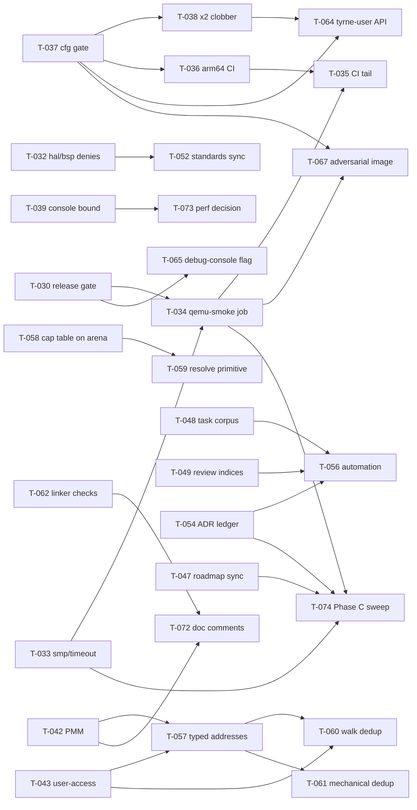

# Phase B.2 — tasks

Tasks belonging to [Phase B.2 — Consolidation & Hardening](../../../roadmap/phases/phase-b2.md), the bridge phase between Phase B and Phase C. The phase is governed by [ADR-0040](../../../decisions/0040-phase-b2-consolidation-bridge.md): it is a **mandatory gate** — Phase C (and D) cannot open until its exit bar is met.

All 46 tasks were opened on 2026-10-11. Task IDs continue the project-wide sequence (T-029 was the last Phase B task). The 141 plan items of `phase-b2.md` are all accounted for (see [Coverage](#coverage)); the 71 polish items stay in `phase-b2.md` as an opportunistic backlog and are **not** exit-gating as a set. Tasks that consume polish gate only their plan items; T-036 and T-056 are optional for the phase exit. The requested Track B.2-1 sequence below includes T-036 explicitly.

## How to use this folder

1. **ADR-0040 was Accepted by the maintainer on 2026-10-11**, following the [independent approval follow-up](../../reviews/code-reviews/2026-10-11-adr-0040-approval-follow-up.md). Acceptance is a phase-level precondition: no task started before it, so individual tasks do not list it as a dependency.
2. Pick the next task from the [recommended order](#recommended-order). Each task's `Dependencies` field is binding; `Informs` is advisory. For the maintainer-requested Track B.2-1 sequence below, the Accepted ADR-0040 execution policy permits a successor after its predecessor's implementation, applicable gates and two fresh review rounds pass on `development`; the predecessor remains `In Review` pending the final PR.
3. Start it with the [`start-task`](../../../../.agents/skills/start-task/SKILL.md) skill's status rules (`Ready` → `In Progress`; update [`current.md`](../../../roadmap/current.md)).
4. **Every task begins by re-verifying its plan item against the live tree** (ADR-0040 rule 5). The source review was static; if an item no longer reproduces, close the task with evidence and no code change.
5. Tasks marked `Draft` carry an open design decision (listed in the task under *Open decisions*); settle design policy through an ADR or an appropriate clarification rider before implementing. Routine implementation choices belong in task history. (T-075 is `Draft` for a different reason: its dependency set is still growing; promote it to `Ready` when the last implementation task is `In Review`.)

## Track B.2-1 implementation sequence (approved 2026-10-11)

The 2026-10-11 preflight review is recorded in [the review artifact](../../reviews/code-reviews/2026-10-11-phase-b2-track1-preflight.md). All seven Track B.2-1 tasks are included, including optional T-036; T-037 is the only cross-track prerequisite included in this sequence. Other tracks retain their existing ownership and scope.

| Step | Task | Deliverable and verification focus |
|------|------|------------------------------------|
| 1 | T-037 | Narrow the bare-metal cfg gates; restore ARM workspace commands and Miri; preserve the debug image's bytes; append the audit amendment and obtain distinct security review. |
| 2 | T-033 | Add validated `--smp N` / `QEMU_SMP` and missing-value handling; verify precedence and invalid input with stubbed QEMU, then real single-core smoke. |
| 3 | T-031 | Enforce userland clippy and ShellCheck; resolve measured findings; prove deliberate lint violations are rejected. |
| 4 | T-030 | Add release build/run aliases, release host tests, an assertion that both release-only tests executed, release kernel clippy, and default/perf-bench build/lint coverage; test the debug-assertions regression. |
| 5 | T-032 | Enforce the HAL/BSP panic-family denies; classify every scoped exception; verify default/perf variants, negative lint probes, Miri and smoke; obtain distinct security review where required. |
| 6 | T-034 | Add required debug and release QEMU smoke with failure artifacts; require the debug EL0 greeting and forbid it in release, require task exit/completion and no fault in both; prove each gate rejects a matching negative trace. |
| 7 | T-036 | Add the required native ARM workspace check/clippy/test/Miri job; verify the arch-only regression is detected and register the remote-green check. |
| 8 | T-035 | Add weekly/on-demand informational performance reports and the classic branch-protection JSON definition with export/check/apply tooling; reconcile live policy without weakening existing protection. |

Each step follows the maintainer's requested cycle: implement → run applicable checks → commit → fresh independent review round → verify/fix findings and commit → second fresh independent review round → verify/fix findings and commit. Code review covers correctness, style, tests, documentation and integration; security-sensitive changes also receive a separate security pass. Agent findings are hypotheses until reproduced or supported by source evidence. Record reviewer identities, reviewed commits, findings, resolutions and command results in task history and review artifacts. Empty review rounds do not generate empty fix commits.

Stay on `development`; negative probes use disposable copies, never alternate branches or deliberately broken commits. Push clean step commits to `development` for hosted verification. Open the final PR after the sequence and integrated documentation/verification pass. Before that PR is reviewed and merged, tasks stay `In Review`: neither a local pass nor an agent verdict substitutes for maintainer authorisation of `Done`. Checks specific to the PR, the first merged `main` run and default-branch workflow registration are recorded when they actually occur, rather than reported as pre-merge evidence.

The scope includes release kernel clippy and release EL0 smoke now. The current hello program ignores a rejected console call and exits cleanly, so release smoke can require the greeting's absence plus task exit/completion without changing userland or the syscall gate. T-065 later re-keys these expectations to its explicit console feature; T-067 remains the separate adversarial-image task. No release runtime coverage is claimed until the actual local and hosted runs pass.

**Sequence implementation status (2026-10-12):** Steps1–8 are implemented, checked, committed and reviewed twice by fresh independent agents. All eight tasks are In Review for the maintainer's final PR. The [phase record](../../../roadmap/phases/phase-b2.md) maps all twelve Track B.2-1 findings to deliveries; each task links full reviews and source-bound evidence. The late T-036 diagnostic-race fix is included in Step8's fresh second round and corrected hosted run38187736985. Six app-bound required checks are live; the full versioned policy matches read-back. First merged-main runs and performance dispatch remain merge-dependent; no sequence implementation is deferred. This status does not complete other tracks or close Phase B.2.

## Index

| ID | Title | Track | Status | Depends on |
|----|-------|-------|--------|------------|
| [T-030](T-030-ci-release-profile-gate.md) | Gate the release profile in CI (build, test, release-only regression tests) | B.2-1 | In Review | — |
| [T-031](T-031-ci-userland-clippy-and-shellcheck.md) | Clippy the userland crates and shellcheck the tooling scripts in CI | B.2-1 | In Review | — |
| [T-032](T-032-panic-family-denies-hal-bsp.md) | Deny panic-family lints in `tyrne-hal` and `tyrne-bsp-qemu-virt` | B.2-1 | In Review | — |
| [T-033](T-033-qemu-tooling-smp-and-timeout.md) | Add `--smp N` and a usage-checked `--timeout` to the QEMU tooling | B.2-1 (+B.2-3) | In Review | — |
| [T-034](T-034-ci-qemu-smoke-job.md) | Add a merge-gating `qemu-smoke` CI job | B.2-1 | In Review | T-030, T-033 |
| [T-035](T-035-ci-hygiene-tail.md) | Track and land the CI hygiene tail (perf-harness schedule, merge gates as code) | B.2-1 | In Review | T-034, T-036 |
| [T-036](T-036-ci-arm64-host-check-job.md) | Add an arm64 host-check CI job *(polish; optional for exit)* | B.2-1 | In Review | T-037 |
| [T-037](T-037-userland-bare-metal-cfg-gate.md) | Fix the bare-metal target gate in the userland crates | B.2-3 | In Review | — |
| [T-038](T-038-console-write-x2-clobber.md) | Mark `x2` as clobbered in the `console_write` syscall shim | B.2-3 | Ready | T-037 |
| [T-039](T-039-console-write-bounded-spin-and-length-cap.md) | Bound `console_write`'s per-byte spin and cap its length | B.2-3 | Draft | — |
| [T-040](T-040-mapperflush-asid-discriminant.md) | Add an AS/ASID discriminant to `MapperFlush` | B.2-3 | Draft | — |
| [T-041](T-041-blockmappedmmu-already-mapped.md) | Make `BlockMappedMmu::map` return `AlreadyMapped` | B.2-3 | Ready | — |
| [T-042](T-042-pmm-defensive-validation.md) | Harden PMM input validation (+ correct the false atomicity comment) | B.2-3 | Ready | — |
| [T-043](T-043-user-access-hardening.md) | Harden the copy-user path (DEVICE exclusion, zero-length probe, top-page test) | B.2-3 | Ready | — |
| [T-044](T-044-bootstrap-as-handle-invariant.md) | Reconcile the bootstrap address-space handle with the real allocation | B.2-3 | Ready | — |
| [T-045](T-045-docs-overview-taskloader-arch-index.md) | Refresh the entry-point architecture docs (overview, task-loader, architecture index) | B.2-2 | Ready | — |
| [T-046](T-046-docs-subsystem-chapters-refresh.md) | Refresh the subsystem architecture chapters (hal, scheduler, exceptions, security-model, memory-management, boot, ipc) | B.2-2 | Ready | — |
| [T-047](T-047-roadmap-state-and-phase-index-sync.md) | Synchronise roadmap live state and phase index | B.2-2 | Ready | — |
| [T-048](T-048-phase-b-task-corpus-sync.md) | Synchronise the Phase B task corpus and fix task-file links | B.2-2 | Ready | — |
| [T-049](T-049-review-indices-sync.md) | Synchronise the review-family indices | B.2-2 | Ready | — |
| [T-050](T-050-entry-docs-and-glossary-sync.md) | Refresh README, guides index, glossary, and the add-bsp skill trace | B.2-2 | Ready | — |
| [T-051](T-051-contributing-and-security-status.md) | Update CONTRIBUTING.md and SECURITY.md to the post-Phase-B state | B.2-2 | Ready | — |
| [T-052](T-052-standards-docs-reality-sync.md) | Reconcile standards claims with CI and lint reality (decisions required) | B.2-2 | Ready | T-032 |
| [T-053](T-053-standards-docs-mechanical-fixes.md) | Apply mechanical corrections to the standards docs | B.2-2 | Ready | — |
| [T-054](T-054-adr-ledger-renumbering-cascade.md) | Cascade the ADR ledger renumbering across phase files | B.2-2 | Ready | — |
| [T-055](T-055-adr-append-only-corrections.md) | Apply append-only corrections to Accepted ADRs | B.2-2 | Ready | — |
| [T-056](T-056-docs-consistency-automation.md) | Automate docs-corpus consistency checks *(polish; optional for exit)* | B.2-2 | Draft | T-048, T-049, T-054 |
| [T-057](T-057-typed-addresses-phys-virt.md) | Give `PhysAddr`/`VirtAddr` an audited API and use typed addresses at public boundaries | B.2-4 | Ready | T-042, T-043 |
| [T-058](T-058-capability-table-on-arena.md) | Rebase `CapabilityTable` storage on the shared `Arena` | B.2-4 | Ready | — |
| [T-059](T-059-capability-resolve-typed-primitive.md) | Introduce a single typed capability-resolution primitive | B.2-4 | Ready | T-058 |
| [T-060](T-060-user-access-walk-helper-dedup.md) | Deduplicate the copy-user per-page walk | B.2-4 | Ready | T-043, T-057 |
| [T-061](T-061-mechanical-dedup-bundle.md) | Remove mechanical duplication (object boilerplate, bitflag types, descriptor encoders, GIC enable/disable) | B.2-4 | Ready | T-057 |
| [T-062](T-062-linker-and-boot-consistency-checks.md) | Add linker and boot consistency checks | B.2-4 | Ready | — |
| [T-063](T-063-syscall-error-taxonomy-polish.md) | Polish the kernel `SyscallError` taxonomy | B.2-4 | Ready | — |
| [T-064](T-064-tyrne-user-api-polish.md) | Polish the `tyrne-user` API (CapWord, error decode, docs) | B.2-4 (+B.2-5) | Ready | T-037, T-038 |
| [T-065](T-065-debug-console-feature-flag.md) | Gate `console_write` on a dedicated `debug-console` feature | B.2-4 | Draft | T-030 |
| [T-066](T-066-bsp-syscall-context-extraction.md) | Extract the BSP syscall-context selection into a host-testable function | B.2-4 | Ready | — |
| [T-067](T-067-adversarial-el0-smoke-image.md) | Add an adversarial EL0 userland image to the smoke suite | B.2-4 | Draft | T-034, T-037 |
| [T-068](T-068-kernel-tests-and-nits-bundle.md) | Close kernel test gaps and clean up nits | B.2-4 | Ready | — |
| [T-069](T-069-unsafe-log-corrections.md) | Correct the unsafe audit log entries | B.2-5 | Ready | — |
| [T-070](T-070-trap-frame-offset-assertions.md) | Pin trap-frame layouts with `offset_of!` assertions | B.2-5 | Ready | — |
| [T-071](T-071-unsafe-contract-hardening.md) | Make unsafe preconditions enforceable (`FrameProvider::alloc_frame`, `add_user_task`) | B.2-5 | Ready | — |
| [T-072](T-072-doc-comment-hygiene.md) | Correct stale doc comments across kernel, HAL, and BSP | B.2-5 | Ready | T-042, T-062 |
| [T-073](T-073-console-write-copy-path-performance-decision.md) | Decide the `console_write` copy-path performance items | B.2-6 | Draft | T-039 |
| [T-074](T-074-phase-c-readiness-sweep.md) | Run the Phase C readiness sweep | readiness | Draft | T-033, T-034, T-047, T-054 |
| [T-075](T-075-phase-b2-closure.md) | Close Phase B.2 | closure | Draft | all non-polish tasks |

## Coverage

Every plan item of [`phase-b2.md`](../../../roadmap/phases/phase-b2.md) is accounted for: 139 by a single owning task, one split between two tasks (T-047 and T-048) and one already fixed by the ADR-0040 kickoff (see below). The counts below are plan items (the review's finding counts), not tasks.

| Track | Items | Owning tasks (items each) and items already done |
|-------|------:|---------------------------|
| B.2-1 CI enforcement & merge gates | 12 | T-030 (4), T-031 (2), T-032 (1), T-033 (1), T-034 (2), T-035 (2) |
| B.2-2 Documentation cascade | 58 | T-045 (5), T-046 (8), T-047 (5), T-048 (6), T-049 (6), T-050 (7), T-051 (1), T-052 (5), T-053 (8), T-054 (1), T-055 (5); 1 fixed at kickoff (no task) |
| B.2-3 Correctness & robustness | 16 | T-037 (3), T-038 (1), T-039 (2), T-040 (1), T-041 (1), T-042 (3), T-043 (3), T-044 (1), T-033 (1, the `smoke.sh --timeout` item) |
| B.2-4 Code quality & API design | 32 | T-057 (5), T-058 (1), T-059 (1), T-060 (1), T-061 (4), T-062 (2), T-063 (2), T-064 (2), T-065 (1), T-066 (1), T-067 (1), T-068 (11) |
| B.2-5 Unsafe-audit & doc hygiene | 21 | T-069 (3), T-070 (1), T-071 (2), T-072 (12), T-064 (3, the `tyrne-user` documentation items) |
| B.2-6 Performance micro-fixes | 2 | T-073 (2) |
| **Total** | **141** | |

The single plan item "`current.md` and T-029's own task file are stale" is owned by T-047 (the `current.md` half); T-048 flips the task file. The plan item about the `phases/README.md` living-document note was already fixed by the ADR-0040 kickoff (counted as "fixed at kickoff" above); T-075's verification report records it as fixed at kickoff. Not plan items, added by the ADR-0040 kickoff: the correction of the false atomicity comment in `pmm.rs` (in T-042; it was routed "now" by `phase-c.md`), and the stale-block cleanup of `current.md` beyond the plan item (in T-047), and, from the PR review, the dotted-ID path-template generalisation and the *Bridge phase* / *Track* glossary entries (in T-050). Polish items consumed by tasks: T-033 (QEMU core-count parameter), T-036 (arm64 host check), T-045 (freshness marker), T-048 (`date_done` template field), T-056 (automation), T-057, T-061, T-064, T-066, T-070, T-074 and others as named in each task.

## Dependency graph

Only hard `Dependencies` are drawn. ADR-0040 `Accepted` is a phase-level precondition for every task (step 1 of *How to use this folder*), not a per-task dependency; T-075 depends on every non-polish task and on any task opened after T-075.

## Recommended order

The waves are a suggestion that respects the dependencies and puts code and CI ahead of documents (ADR-0040 consequences: the phase must not repeat the plan-outruns-execution pattern). Tasks within a wave are independent unless the graph says otherwise.

| Wave | Goal | Tasks |
|------|------|-------|
| 0 | Governance | Accept ADR-0040. Decide whether the local-only 2026-07-15 review should be tracked (nothing in B.2 depends on it). |
| 1 | Restore and extend the verification loop; close the small HIGH defects | T-037 → T-038; T-033; T-030; T-031; T-032; T-041; T-042; T-043; T-044; T-051 (small, highest-visibility documentation fix) |
| 2 | Make the gates real; remaining HIGH behaviour | T-034 (after T-030 and T-033); T-036 (after T-037, included in the requested Track B.2-1 sequence); T-035 (after T-034 and T-036; its decisions first); T-039 and T-040 (both need a recorded decision first) |
| — | **Scope checkpoint (ADR-0040 rule 8):** reassess the remaining scope on evidence. Changing the chosen scope to Option B requires a new superseding ADR; a revision note cannot reverse the Accepted outcome. | |
| 3 | Documentation catch-up (can run in parallel with Wave 4) | T-045, T-046, T-048, T-049, T-050, T-053, T-055, then T-047, T-054, T-052 (after T-032) |
| 4 | Quality refactors, now guarded by live gates | T-057 → T-060, T-061; T-058 → T-059; T-062; T-063; T-064; T-066; T-068; decisions first for T-065 and T-067 |
| 5 | Unsafe-audit and doc-comment hygiene; the perf decision | T-069, T-070, T-071, T-072, T-073 |
| 6 | Readiness and closure | T-074, then T-075 |
| optional | Polish; may close as carry-forwards | T-056; T-036 remains phase-optional but is included in Wave 2 for the requested Track B.2-1 sequence. |

Security-sensitive refactors — T-058, T-059, T-060, T-065, T-066, T-070, T-071 — should start only after T-030 and T-034 are `Done`, so a regression is caught by CI rather than by hand.

## Conventions

- Files are named `T-NNN-<slug>.md`; sections follow [`../TEMPLATE.md`](../TEMPLATE.md); statuses follow the [vocabulary](../README.md#status-vocabulary). The `Phase` field reads `B.2` and `Milestone` reads `Track B.2-N` (T-074 reads `Track B.2 readiness`, T-075 reads `B.2 closure`).
- When a task is split, the original ID stays and the new tasks take the next free numbers (continue after T-075); add them to this index in the same change.
- When a task becomes `Done`, add a `date_done` field to its frontmatter (the T-019 precedent, formalised by [T-048](T-048-phase-b-task-corpus-sync.md)) and update this index.
