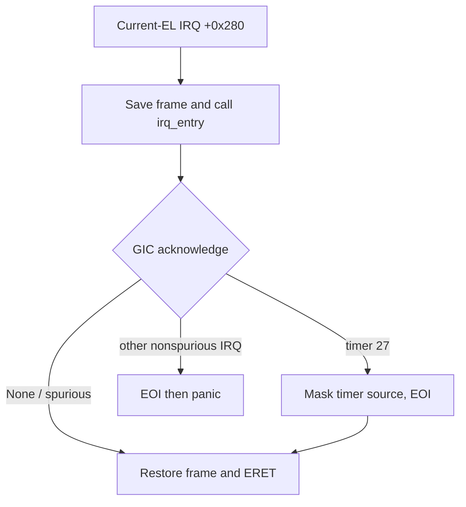

# Exception infrastructure and interrupt delivery

The QEMU BSP installs EL1 vectors, handles current-EL timer IRQs and dispatches live EL0 SVCs through the kernel's typed syscall boundary. Other synchronous execution faults remain panic-class. This chapter separates installed infrastructure from runtime evidence and distinguishes cooperative context preservation, initial EL0 scrubbing and the incomplete asynchronous FP/SIMD trap-state contract.

> **Last verified against:** 2026-10-13; source da18ed5c2a2d8b3d61f82337a9da021d05d73451; owner [T-046](../analysis/tasks/phase-b2/T-046-docs-subsystem-chapters-refresh.md).

## Context

[T-012](../analysis/tasks/phase-b/T-012-exception-and-irq-infrastructure.md) implemented vectors/GIC/timer support; [ADR-0011](../decisions/0011-irq-controller-trait.md) and [ADR-0010](../decisions/0010-timer-trait.md) define the traits. [T-021](../analysis/tasks/phase-b/T-021-syscall-dispatch.md), [ADR-0030](../decisions/0030-syscall-abi.md) and [ADR-0031](../decisions/0031-initial-syscall-set.md) added SVC dispatch. [T-028](../analysis/tasks/phase-b/T-028-el0-userspace-wireup.md) exercised real EL0 entry/exit, replacing the earlier EL1 proxy smoke. A [capability](../glossary.md) check belongs to syscall dispatch; trap entry supplies execution context, not authority by itself.

## Design

### Vector table at `VBAR_EL1`

[`vectors.s`](../../bsp-qemu-virt/src/vectors.s) contains 16 entries at 0x80-byte strides, with a 2-KiB-aligned base. Each four-entry group is sync, IRQ, FIQ, SError.

| Origin group | Base | Current behavior |
|--------------|------|------------------|
| Current EL, SP0 | `+0x000` | Panic-class entries. |
| Current EL, SPx | `+0x200` | Sync SVC decoder at +0x200; IRQ trampoline at +0x280; FIQ/SError panic. |
| Lower EL, AArch64 | `+0x400` | Live EL0 SVC path at +0x400; IRQ at +0x480 and other classes panic. |
| Lower EL, AArch32 | `+0x600` | Panic-class entries; no AArch32 user ABI. |

The BSP installs VBAR twice: its low alias before identity MMU enable, then its high alias during TTBR1 migration. IRQ unmasking follows valid vectors and GIC initialization. An invalid vector/console mapping can still prevent useful fault diagnosis.

The shared sync trampoline compares ESR.EC to SVC64. Other sync faults call `panic_entry`; EL0 faults therefore panic the **whole kernel**, not merely the offending task. EL0 currently runs with DAIF masked (`0x3c0`), consistent with cooperative execution; lower-EL IRQ dispatch is not a working userspace-driver path.

The installed +0x200 path was the B5 EL1-stub proxy. The real +0x400 path was runtime-exercised by T-028 and is present in both [retained fresh debug/release traces](../analysis/reports/2026-10-13-t045-architecture-verification.md): two SVCs each, zero other exception events. These are manual raw-log counts; smoke.sh itself asserts profile markers and fault rejection, not exact SVC counts. Default hello does not exercise task_yield, IPC syscalls or IRQ delivery.

### Dispatch flow (IRQ path)

The current-EL IRQ trampoline saves a 192-byte frame: x0–x18, LR, ELR_EL1 and SPSR_EL1, plus 16 reserved bytes. Callee-saved GPRs survive the ordinary Rust call ABI. Reserved bytes are not written by assembly and the custom Debug formatter redacts them; that redaction is not an independent Rust validity or memory-safety proof. A compile-time size assertion pins 192 bytes, while review must still check field offsets against assembly.

The IRQ path neither switches tasks nor mutates the scheduler.



There is **no SIMD register save** in this IRQ frame. Boot enables FP/SIMD; cooperative d8–d15 preservation and first-entry scrub do not repair that asynchronous gap. Full trap-state preservation is a [Phase D](../roadmap/phases/phase-d.md) hardware prerequisite, not an assurance established by QEMU's default no-IRQ demo.

### Syscall dispatch (sync / SVC path) — T-021

`SyscallTrapFrame` is 272 bytes: x0–x30, ELR_EL1, SPSR_EL1 and alignment padding. Its repr(C) field order mirrors assembly and its size is asserted at compile time. It likewise does not save full SIMD/FP state. The input ABI uses x8 for number and x0–x5 for arguments; status/payload return through x0–x7.

Actual EL0 SVC processing has a returning and a non-returning arm.

```mermaid
sequenceDiagram
    participant U as EL0 task
    participant V as Sync trampoline +0x400
    participant B as BSP syscall_entry
    participant K as Kernel dispatcher
    U->>V: SVC #0
    V->>B: saved GPR frame
    B->>B: resolve complete current table/window/AS binding
    B->>K: dispatch typed number and arguments
    alt Resume
        K-->>B: status and payload
        B->>V: write x0-x7
        V-->>U: restore and ERET
    else Reschedule
        K-->>B: self-yield effect
        B->>B: yield, resume later, set success status
        B->>V: return on same task's stack
        V-->>U: restore and ERET
    else Terminate
        K-->>B: self-exit effect
        B->>B: task_exit_current, abandon frame
        Note over B: Non-returning; no ERET to exiting task
    end
```

The BSP gets table/window by current scheduler slot and generation-resolves the AS. Any missing/stale required component selects the empty table/window and disables current-task controls. No Task-generation or table-pointer identity revalidation is performed; trusted registration/lifetimes are the current assumption.

The decoder recognizes only five v1 calls, and recognizes console_write=5 only with debug_assertions. Normal release rejects 5 before capability lookup. In debug, ConsoleWrite checks DebugConsole/CONSOLE_WRITE, whole range and all USER page translations before copying/output. IPC syscalls use bare primitives; blocking EL1 bridges are separate. [T-025](../analysis/tasks/phase-b/T-025-user-access-translation.md), [T-026](../analysis/tasks/phase-b/T-026-current-task-cap-table.md) and [ADR-0038](../decisions/0038-mmu-translate-and-user-access.md) supply the live user-memory/binding boundary.

`task_exit` dispatches away without reclamation. `task_yield` is wired but hello does not call it. Typed syscall-input errors must not be mistaken for general fault supervision. Specific exception panic diagnostics do not imply every kernel panic dumps registers.

### GIC v2 driver

[`QemuVirtGic`](../../bsp-qemu-virt/src/gic.rs) owns volatile distributor/CPU-interface MMIO. Initialization disables lines and establishes controller/CPU-interface state before DAIF.I is cleared. `acknowledge` maps spurious IDs to None; recognized active IDs require EOI. Current timer arming enables PPI 27. Acknowledged unexpected IRQs receive EOI before panic; spurious None receives none.

The trait exposes enable/disable/acknowledge/EOI, not routing/priority configuration or userspace IRQ capability delivery. No device driver is woken by this handler. [UNSAFE-2026-0019](../audits/unsafe-log.md) covers the MMIO implementation and its retained verification boundaries.

### Generic-timer IRQ wiring

The virtual generic timer uses CNTVCT_EL0 and PPI 27. `arm_deadline(absolute_ns)` converts nanoseconds to ticks with **round-up** and saturating arithmetic, writes CNTV_CVAL_EL0, writes CNTV_CTL_EL0=`01` (enable/unmask), then enables the GIC line. `cancel_deadline` writes `10` (disable/mask), then disables the line. Pure conversion tests live in [`hal/src/timer.rs`](../../hal/src/timer.rs).

On IRQ 27, the handler writes CNTV_CTL_EL0=`10`, EOIs and returns. It does not schedule, rearm a periodic tick or wake a sleeping task. The audit/security records retain future arming/cancellation race and actual delivery-verification concerns. No default-demo caller arms a deadline, so fresh smoke does not close that gap. [UNSAFE-2026-0021](../audits/unsafe-log.md) records the timer-register writes.

### Idle's `wfi` activation

The installed idle entry unmasks IRQs, then loops WFI followed by `yield_now` with the activation callback. Under [ADR-0026](../decisions/0026-idle-dispatch-fallback.md) it is a **fallback**, never the FIFO head. T-012 replaced the interim spin body with WFI; later fallback fixes prevent it displacing real ready work.

Default boot ends in Task A's completion busy-spin, so that path never selects idle or demonstrates WFI wake. Timer/GIC installation is infrastructure; a real armed-deadline workload is needed for delivery evidence. Existing historical B1 completion/Miri results are not newly pending solely because this chapter is refreshed; the explicitly retained IRQ-take audit gap is the remaining separate issue.

### IRQ-handler interaction with the raw-pointer scheduler bridge

The [ADR-0021 revision](../decisions/0021-raw-pointer-scheduler-ipc-bridge.md#revision-notes) extends the no-mutable-reference-across-switch rule to IRQ contexts. Current `irq_entry` has no mutable Scheduler borrow, so it does not add a scheduler alias or context switch. It runs with IRQ masking and handles only the recognized source. A future wake/preemption path needs deliberate ownership, atomic binding and trap-state work; it cannot inherit correctness merely by adding an on_timer call here.

## Implementation map

| Surface | Source / audit context |
|---------|------------------------|
| Vector entries and IRQ/sync frames | [vectors.s](../../bsp-qemu-virt/src/vectors.s), UNSAFE-2026-0020/0029. |
| IRQ and panic handlers | [exceptions.rs](../../bsp-qemu-virt/src/exceptions.rs), UNSAFE-2026-0020. |
| Typed syscall frame/current binding/effects | [syscall.rs](../../bsp-qemu-virt/src/syscall.rs), UNSAFE-2026-0029/0030 and bridge contracts. |
| GIC/timer implementation | [gic.rs](../../bsp-qemu-virt/src/gic.rs), [cpu.rs](../../bsp-qemu-virt/src/cpu.rs), UNSAFE-2026-0019/0021. |
| Vector/GIC/table publication and real EL0 registration | [main.rs](../../bsp-qemu-virt/src/main.rs), T-022/T-028 and UNSAFE-2026-0031/0032 amendments. |

These are existing audit scopes; this prose-only refresh introduces no new unsafe approval. Source and dated audit amendments take precedence over old adjacent comments.

## Invariants

- VBAR is aligned/installed before IRQ unmasking and rebased high before low-root release.
- Spurious acknowledgements do not EOI; recognized timer IRQ masks its source and EOIs; other active IDs EOI before panic.
- Syscall frame GPR layout matches assembly; each return/control effect follows its distinct resume/yield/terminate path.
- User-copy authority/range/page validation precedes debug output; default release decode rejects console 5 first.
- Current IRQ handling performs no scheduling; complete FP/SIMD preservation, hostile fault containment and IRQ-rich stack headroom are not supplied by these invariants.

## Trade-offs

Panic-class unexpected exceptions simplify bring-up at kernel-wide availability cost. Ack/mask/EOI avoids scheduler reentrancy but provides no timed scheduling. Fixed frames preserve current GPR contracts while leaving FP/SIMD hardware debt explicit. A default demo that never arms IRQs cannot validate every installed handler; host tests and retained traces have different coverage.

## Open questions

Phase C owns atomic caller binding before C2/C3 and SP_EL1 high-water validation before C3 IRQ-rich work. Phase D owns full trap-state and hardware correctness. Phase E owns TaskFault supervision/lifecycle with untrusted services. A real deadline workload must satisfy existing audit verification notes before claiming timer delivery or idle wake; this refresh does not erase those notes or reopen closed historical tasks.

## References

- [Boot](boot.md), [memory management](memory-management.md), [HAL](hal.md), [scheduler](scheduler.md), [security model](security-model.md).
- [Kernel dispatcher and tests](../../kernel/src/syscall/dispatch.rs), [ABI](../../kernel/src/syscall/abi.rs), [unsafe audit](../audits/unsafe-log.md).
- [ADR-0037](../decisions/0037-el0-entry-context.md), [ADR-0039](../decisions/0039-userland-build-pipeline.md).
