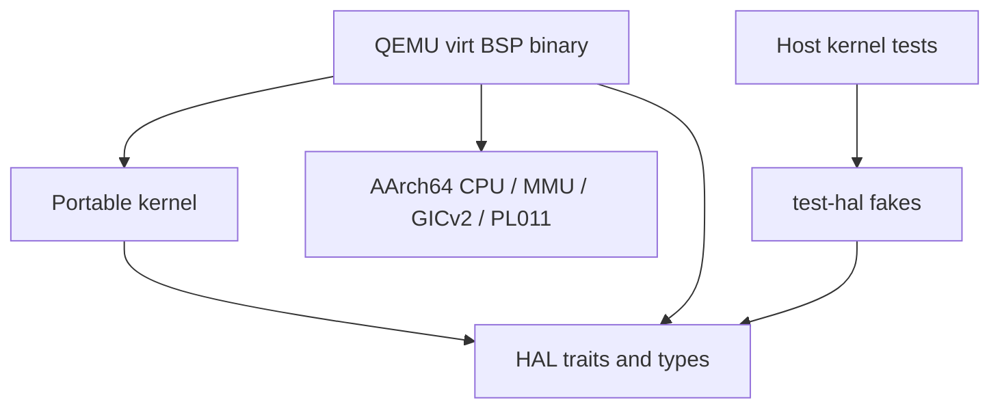

# Hardware Abstraction Layer (HAL) design

The HAL separates portable kernel mechanisms from privileged CPU and board operations. The kernel calls Rust traits; the QEMU virt Board Support Package (BSP) implements them. This chapter describes the current interfaces, the live EL0 entry mechanism and the limits a new BSP must respect. Userspace drivers are the architectural direction; today's boot console, interrupt controller and timer implementations run in the privileged BSP.

> **Last verified against:** 2026-10-13; source da18ed5c2a2d8b3d61f82337a9da021d05d73451; owner [T-046](../analysis/tasks/phase-b2/T-046-docs-subsystem-chapters-refresh.md).

## Context

[ADR-0001](../decisions/0001-microkernel-architecture.md), [ADR-0004](../decisions/0004-target-platforms.md) and architectural [principles P3/P6](../standards/architectural-principles.md) motivate a narrow privileged surface and per-board builds. A [capability](../glossary.md) grants authority; a HAL trait abstracts the operation that implements a mechanism. A trait call alone is not an untrusted caller's authorization check.

Only `bsp-qemu-virt` exists today. Pi 4 and later platforms remain roadmap work; an interface implemented on QEMU is not evidence of hardware correctness on those boards.

## Design

### What the HAL is, and is not

The HAL contains types and traits for CPU state, cooperative context switching, translation, IRQ control, time and console output. Pure descriptor/timer arithmetic also lives here so host tests can exercise it. Privileged register writes, MMIO and assembly live in BSP implementations, under the [unsafe policy](../standards/unsafe-policy.md).

It is not a general peripheral framework, device-tree parser, service discovery mechanism or POSIX API. Userspace block/network/device services are planned. No portable `BootInfo` handoff, hardware-discovery service or userspace IRQ delivery API exists in the current tree.

### Where the HAL lives in the layering

The BSP binary composes portable kernel mechanisms with concrete implementations. Host tests substitute fakes at the trait boundary.

The kernel manifest does not depend on a BSP. Changing the BSP produces a different binary; no runtime board selector exists.

### HAL trait surface

These are implemented interfaces, not provisional Phase-A sketches. Their exact signatures and safety contracts are in [`hal/src`](../../hal/src/). Additive changes require their motivating decision record.

#### `Cpu`

[`Cpu`](../../hal/src/cpu.rs), governed by [ADR-0008](../decisions/0008-cpu-trait.md), is `Send + Sync` and object-safe:

- `current_core_id()` returns a `CoreId`.
- `disable_irqs()` saves an `IrqState`; `restore_irq_state(state)` restores it.
- `wait_for_interrupt()` provides WFI on the QEMU BSP.
- `instruction_barrier()` provides ISB.

`IrqGuard` pairs disable/restore through RAII. There is no secondary-core-start, online-core-count or dedicated enable-interrupts method. `IrqState(0)` represents the unmasked state in the current implementation. Boot/GIC setup remains BSP-owned; the trait does not initialize an interrupt controller.

#### `ContextSwitch`

[ADR-0020](../decisions/0020-cpu-trait-v2-context-switch.md) separates [`ContextSwitch`](../../hal/src/context_switch.rs) from `Cpu`. It defines `TaskContext: Default + Send` and three unsafe operations:

| Operation | Contract |
|-----------|----------|
| `context_switch(current, next)` | Save current callee-saved state and restore an initialized next context while IRQs are masked. The saving call returns when that original task is later resumed. |
| `init_context(ctx, entry, stack_top)` | Seed a non-returning EL1 entry on a live, aligned stack. |
| `init_user_context(ctx, user_entry, user_sp, kernel_stack_top)` | Seed first entry to EL0; caller supplies valid user mappings and an adequate live kernel trap stack, and activates the task AS before dispatch. |

The QEMU context saves `x19`–`x28`, FP/LR/SP and `d8`–`d15` (lower 64 bits of `v8`–`v15`), as required by the cooperative ABI. This is not full asynchronous FP/SIMD preservation.

The EL0 path is live: [T-023](../analysis/tasks/phase-b/T-023-el0-entry-context.md) supplies the context/trampoline, [T-024](../analysis/tasks/phase-b/T-024-task-create-from-image.md) creates the Task, and [T-028](../analysis/tasks/phase-b/T-028-el0-userspace-wireup.md) registers and runs the [ADR-0039](../decisions/0039-userland-build-pipeline.md) image. Before first ERET, the trampoline installs SP_EL0/ELR_EL1, selects EL0t with DAIF masked and scrubs `x0`–`x30`, `v0`–`v31`, FPCR/FPSR and both EL0 thread-ID registers, per [ADR-0037](../decisions/0037-el0-entry-context.md). This initial scrub does not prove ongoing FP/SIMD trap isolation. The current 4 KiB per-task SP_EL1 stack still needs high-water validation before the richer IRQ work identified in [Phase C](../roadmap/phases/phase-c.md).

#### `Mmu`

[`Mmu`](../../hal/src/mmu/mod.rs) follows [ADR-0009](../decisions/0009-mmu-trait.md) and [ADR-0027](../decisions/0027-kernel-virtual-memory-layout.md). Its associated `AddressSpace: Send` has eight operations: unsafe `create_address_space(root)`, `address_space_root`, `activate`, `map`, `unmap`, `translate`, `invalidate_tlb_address` and `invalidate_tlb_all`. `map`/`unmap`/`translate` report `MmuError`; there is no shared `HalError`.

`map` accepts a kernel-provided `FrameProvider` for intermediate tables. Thus HAL mapping can request physical frames through a callback; it does not depend on a global heap. The current format is 4 KiB VMSAv8 with lazy intermediate tables; map does not split an existing block mapping. Pure [descriptor encoders](../../hal/src/mmu/vmsav8.rs) implement permission bits and are host-tested.

`map` returns a `MapperFlush`; `unmap` returns a flush token and the removed frame. Callers explicitly flush the VA or document `ignore()` followed by a batched full invalidation. `#[must_use]` and the workspace lint catch accidental unused returns; explicit discarding can bypass that lint, so this is not a linear type proof. Current activation uses ASID 0 and invalidates translations; no per-ASID or generic cache-maintenance/granule-selection API exists. See [memory management](memory-management.md).

#### `IrqController`

[`IrqController`](../../hal/src/irq_controller.rs), [ADR-0011](../decisions/0011-irq-controller-trait.md), exposes `enable`, `disable`, `acknowledge() -> Option<IrqNumber>` and `end_of_interrupt`. Routing, priority and trigger configuration are not methods on this trait. BSP initialization configures GICv2 directly.

The current ISR acknowledges, handles the known timer source or panics after EOI for an unexpected nonspurious interrupt. It does not notify a userspace driver. Spurious acknowledge returns None without EOI. The default demo arms no deadline; installed IRQ support is distinct from demonstrated delivery.

#### `Timer`

[`Timer`](../../hal/src/timer.rs), [ADR-0010](../decisions/0010-timer-trait.md), has `now_ns`, `arm_deadline(absolute_ns)`, `cancel_deadline` and `resolution_ns`. QEMU uses the virtual generic-timer family: CNTVCT for reads, CNTV_CVAL/CNTV_CTL for deadlines. Counter-to-nanosecond conversion rounds down with saturating arithmetic; nanosecond-to-tick conversion rounds up so a sub-tick deadline is not programmed early. Resolution rounds the period and clamps it to at least one nanosecond.

These are counter-derived timestamps, not timestamps rebased to zero at kernel entry. Default boot measures elapsed time by subtraction. Arming enables the virtual timer PPI; cancellation masks/disables it. The known future arming/race and IRQ-verification limits remain in [exceptions.md](exceptions.md) and the audit record.

#### `Console`

[`Console`](../../hal/src/console.rs) exposes `write_bytes(&[u8])` with no Result. `FmtWriter` adapts it to formatting. QEMU's privileged PL011 console remains available for boot and panic reporting; its polling behavior is not a bounded availability guarantee. The debug EL0 console syscall performs capability/user-memory checks before calling it, as described in [overview](overview.md#syscall-surface).

#### `Iommu`

`Iommu` in [`hal/src/lib.rs`](../../hal/src/lib.rs) is an empty placeholder with no implementation or isolation guarantee. [ADR-0036](../decisions/0036-qemu-virt-gicv2-no-iommu-v1.md) records the deferred SMMUv3 direction; see [security model](security-model.md).

### BSPs: what each BSP crate owns

The current BSP owns reset assembly, linker layout, concrete CPU/MMU/GIC/timer/console implementations, exception vectors and syscall entry, trusted image embedding, boot object/table setup and scheduler publication. Constants currently live in those concrete modules; no `bsp::config` organization or source-line threshold is a correctness contract.

### BSP selection

The real package is `tyrne-bsp-qemu-virt`. Build the matching user image first with `tools/build-userland.sh`, then `cargo build -p tyrne-bsp-qemu-virt --target aarch64-unknown-none`; the [QEMU guide](../guides/run-under-qemu.md) and smoke tooling describe orchestration. The shared generated image path requires sequential matching-profile builds. No Pi package exists yet.

### Initial BSPs

QEMU virt is the current development target: one active core, 128 MiB RAM at `0x4000_0000`, image PA `0x4008_0000`, PL011 at `0x0900_0000`, GICv2 and the virtual generic timer. These describe the supplied configuration, not arbitrary QEMU machines. Pi 4 is the first planned hardware BSP in [Phase D](../roadmap/phases/phase-d.md); Pi 5 and later targets follow the support-tier policy in ADR-0004. Their firmware, DMA, address layout and secondary-core contracts require bring-up evidence rather than copying QEMU assumptions.

### Boot handoff, in detail

The actual handoff stays in the BSP: `_start` reaches `kernel_entry`, then high-half `kernel_main_high` composes portable mechanisms and starts the scheduler. There is no `kernel_main(boot_info)` or `Timer::init()` trait call. [Boot flow](boot.md) documents reset, TTBR migration, PMM/image construction, per-task table publication and EL0 dispatch.

### Error handling in the HAL

The signatures determine error behavior. MMU operations use typed errors, frame provision uses Option, and CPU/IRQ/timer/console methods generally return no error. Trusted boot uses fail-stop checks for unrecoverable setup failures. No blanket permission to panic on privileged hot paths follows from this chapter; [error handling](../standards/error-handling.md) and scoped lint policy still apply.

### `unsafe` in the HAL

Traits concentrate explicit context/mapping contracts; implementations contain audited register/MMIO/assembly operations. Each applicable site needs its SAFETY rationale, audit entry and independent security review. A trait's safe method does not remove the implementation's unsafe obligations or prove a future BSP's compliance.

### Testing the HAL

[`test-hal`](../../test-hal/src/) exists: fake CPU/context switch, metadata MMU, queued IRQ controller, captured console and deterministic timer. The timer allows setting/advancing time and recording deadlines; it does not automatically emulate physical IRQ delivery. Host tests exercise portable contracts; QEMU smoke exercises composition on the real BSP. Neither supplies Pi hardware validation. Current retained debug/release evidence is [source-bound](../analysis/reports/2026-10-13-t045-architecture-verification.md); no new host/coverage run is claimed here.

## Invariants

- Kernel mechanisms consume HAL types/traits without depending on the QEMU BSP crate.
- Context-switch callers keep contexts/stacks live and mask IRQs across the unsafe switch; resumed calls return to their original task.
- First EL0 dispatch requires an active task AS, valid user PC/SP and a live kernel trap stack.
- Mapping changes carry an explicit flush decision; review still checks correct invalidation scope.
- BSP selection is compile-time, and no proprietary blob is added to the Tyrne build.

## Trade-offs

A narrow HAL reduces portable kernel coupling but leaves substantial privileged bring-up in the BSP. Compile-time selection requires per-board artifacts. Single-core, ASID-0 translation and cooperative context switching simplify today's contracts while leaving preemption, shootdown and complete asynchronous register preservation for later work. Host fakes provide repeatable contract tests with less hardware fidelity than QEMU or silicon.

## Open questions

Secondary-core rendezvous and shootdown belong to [Phase C](../roadmap/phases/phase-c.md); hardware trap-state/cache/translation correctness belongs to [Phase D](../roadmap/phases/phase-d.md). Device-tree handoff, errata organization, power management and an implemented IOMMU require concrete platform requirements and decision records. Today's signatures must not be treated as a promise that these additions require no changes.

## References

- [CPU/context implementation](../../bsp-qemu-virt/src/cpu.rs), [MMU](../../bsp-qemu-virt/src/mmu.rs), [GIC](../../bsp-qemu-virt/src/gic.rs), [console](../../bsp-qemu-virt/src/console.rs).
- [Scheduler](scheduler.md), [exceptions](exceptions.md), [task loader](task-loader.md), [unsafe audit](../audits/unsafe-log.md).
- [Architecture index and freshness convention](README.md#conventions).
