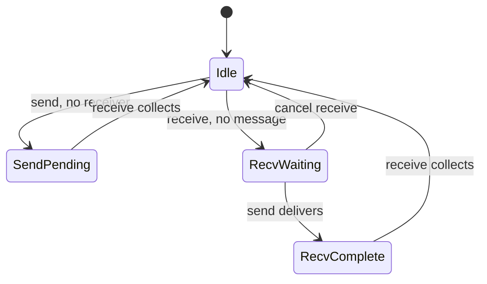
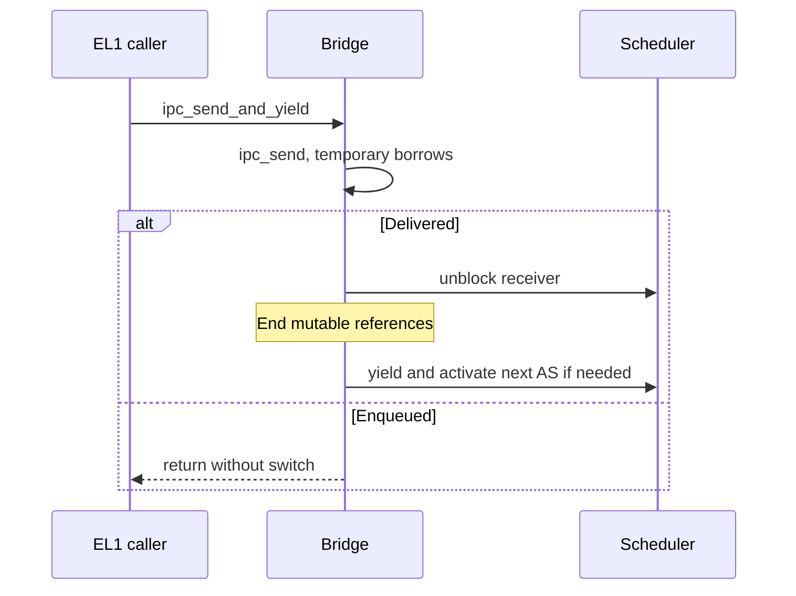

# Inter-process communication (IPC)

Tyrne's IPC primitives implement depth-one endpoint rendezvous and OR-bit notifications, mediated by [capabilities](../glossary.md). The primitives return immediately; separate EL1 scheduler bridges add receive blocking and selected yields. A message may move one capability through endpoint state into the receiver's table. This chapter explains those distinct contracts and the current transfer, generation and lifecycle limits.

> **Last verified against:** 2026-10-13; source da18ed5c2a2d8b3d61f82337a9da021d05d73451; owner [T-046](../analysis/tasks/phase-b2/T-046-docs-subsystem-chapters-refresh.md).

## Context

[ADR-0017](../decisions/0017-ipc-primitive-set.md) selects send/receive/notify; [ADR-0018](../decisions/0018-badge-scheme-and-reply-recv-deferral.md) defers badges and reply-recv. [ADR-0021](../decisions/0021-raw-pointer-scheduler-ipc-bridge.md) explains why switches use raw-pointer free functions. [ADR-0030](../decisions/0030-syscall-abi.md) and [ADR-0031](../decisions/0031-initial-syscall-set.md) expose send/receive through EL0, without exposing notify or adding the EL1 blocking bridge to syscall dispatch. The source and boundary tests live together in [`kernel/src/ipc/mod.rs`](../../kernel/src/ipc/mod.rs); its changing line count is not a design bound.

## Design

### The three primitives

`Message` is a caller-controlled `u64` label and three `u64` parameters. It contains no user pointer for the kernel to dereference and no authenticated badge. The optional transferred capability is separate from those four payload words.

| Primitive | Required object/right | Result and scheduling |
|-----------|-----------------------|-----------------------|
| `ipc_send` | Endpoint/SEND; optional source cap/TRANSFER | Delivered or Enqueued; never switches by itself. |
| `ipc_recv` | Endpoint/RECV | Received with optional receiver-table handle, or Pending; never switches by itself. |
| `ipc_notify` | Notification/NOTIFY | ORs bits into a u64 word; no waiter wake-up and no v1 EL0 syscall. |

Validation resolves the caller's handle, checks object kind and operation right, then resolves the object arena handle. Endpoint and Notification arenas each have 16 slots; capability tables have 64. These fixed bounds do not provide per-subject quotas or hostile-workload availability.

### `Endpoint` and its state machine

Endpoint state parks a message/capability or records one registered receiver; it does not itself park a sender Task.

`SendPending` and `RecvComplete` hold `Message` plus `Option<Capability>`. `RecvWaiting` holds no message or capability. Conflicting arrivals produce QueueFull; a second receive on RecvWaiting does not register another waiter. Delivered means the message is available for collection, not that a receiver has already run or received its installed handle.

[`ipc_cancel_recv`][cancel-recv], added under [ADR-0032](../decisions/0032-endpoint-rollback-and-cancel-recv.md), reverses a receive registration. The receive bridge uses it when dispatch would deadlock. It is a trusted kernel recovery primitive, absent from the EL0 ABI. Future destruction/drain policies require their own lifecycle work rather than assuming cancellation handles in-flight capabilities.

[cancel-recv]: ../../kernel/src/ipc/mod.rs

### `IpcQueues`: states + slot generations

A parallel endpoint-generation array prevents a reused slot from inheriting the old logical rendezvous. Both state and peek helpers call `reset_if_stale_generation`; a generation mismatch resets state to Idle. This housekeeping can mutate cached state even on a later rejected operation, so “every error is byte-for-byte mutation-free” would be incorrect.

If stale state holds an in-flight capability, debug builds assert before resetting. Release builds reset without that assertion and discard the pending capability value. This does not reclaim the referenced object or safely implement a transfer-drain lifecycle; destruction must drain authority before slot reuse. Existing stale-state tests cover the debug assertion and cap-free resets. No current production drain guarantee is inferred from them.

### Capability transfer

Send and receive have separate preflights:

1. Send validates Endpoint/SEND, transfer handle/TRANSFER, live endpoint and available endpoint state. `cap_take` then removes a **leaf** capability from the sender table; HasChildren becomes InvalidTransferCap. The slot generation changes and the capability value moves into endpoint state.
2. Receive peeks the pending state and checks receiver-table capacity before consuming a pending cap. A full table returns ReceiverTableFull while preserving the message/cap for retry. `is_full()` checks whether the free-list head is absent (`free_head.is_none()`); it does not reserve a slot.
3. Receive consumes the pending message/cap and installs the cap as a new root in the receiver table. Rights are not widened, and the receiver obtains a fresh local handle.

Under current exclusive cooperative access, those preflights protect the logical move against the stated rejections. They are not one cross-task atomic operation, a global no-error-mutation claim or an SMP transaction. `Capability` itself is neither Copy nor Clone; explicit authorized `cap_copy` can still create another value referring to the same object. Transfer moves this value once, rather than promising unique object authority throughout the system.

Received roots do not retain cross-table derivation ancestry. Sender-side revocation does not reach them. [ADR-0023](../decisions/0023-cross-table-capability-revocation-policy.md) records the deferred cross-table decision; keeping a local child does not restore revocation of the new remote root.

### `IpcError` taxonomy

The non-exhaustive enum has these current variants:

| Error | Meaning |
|-------|---------|
| StaleHandle | Operation capability is invalid/stale or its object no longer resolves. |
| WrongObjectKind | Operation capability names another kind. |
| MissingRight | Endpoint/notification operation right is missing. |
| QueueFull | Existing rendezvous state rejects the arrival. |
| InvalidTransferCap | Transfer lookup/right check fails, or cap_take rejects a non-leaf. |
| ReceiverTableFull | Pending capability cannot fit; pending authority is preserved. |
| PendingAfterResume | Receive bridge resumed without a collectable message; not produced by bare ipc_recv. |

The first three follow resolve → kind → right, matching ADR-0030's per-caller error taxonomy. Typed errors describe the caller's own supplied handles; they are not a timing noninterference proof. `PendingAfterResume` replaces an untestable assertion with a typed bridge invariant failure under ADR-0022's rider.

### The scheduler-bridge wrappers

The EL1 wrappers add scheduler behavior to the primitives. They take raw pointers plus the CPU and AS-activation callback; mutable references end before switching.

`ipc_recv_and_yield` attempts receive, marks current Blocked on Pending, selects another ready task or idle, then collects on resumption. With no usable dispatch candidate it restores scheduler state and cancels the receive registration; it also rejects the blocking idle task selecting itself. A resumed Pending becomes PendingAfterResume.

The actual EL0 dispatcher instead returns the bare primitive outcome in ABI registers. EL0 send/receive do not automatically block or wake a bridge-blocked receiver; service composition requiring that behavior is future work. Yield and exit are separate control effects.

### BSP-side discipline

[`task_a`/`task_b`](../../bsp-qemu-virt/src/main.rs) pass distinct, live scheduler/arena/queue/table pointers acquired through the BSP static-cell helpers. Callers must not create conflicting references or reuse pointers invalidated by intervening exclusive reborrows. [UNSAFE-2026-0013/0014](../audits/unsafe-log.md) record the contracts; host tests/Miri exercise portions of the discipline, not assembly execution or a universal aliasing proof. IRQ handling currently does not mutate the scheduler. Preemption/SMP require a new ownership/concurrency argument.

The [retained debug/release traces](../analysis/reports/2026-10-13-t045-architecture-verification.md) show the EL1 request/reply demo interleaved with trusted EL0 hello/exit. They do not exercise all error states, optional cap transfer, notify wake-up or future service protocols. No fresh test count or coverage percentage is claimed by this prose refresh.

## Invariants

- Endpoint operations require the caller's matching Endpoint kind and SEND/RECV right; notify requires Notification/NOTIFY.
- A successful transfer takes a leaf value from the sender before parking it; receive does not widen its rights.
- A full receiver table leaves pending message/cap available for retry, after generation housekeeping.
- Each endpoint has one rendezvous state; scheduler-blocked Task state is separate.
- Mutable bridge references end before a context switch, under the audited single-core caller contracts.

## Trade-offs

Depth-one state is small and testable but cannot implement fan-in/fan-out without caller coordination or a new contract. The bare receive is nonblocking yet registers a waiter; a future polling operation may need semantics without that side effect. Separate reply and receive cost additional entries compared with a composite, deferred by ADR-0018. New-root transfers simplify local tables while leaving cross-table revocation unresolved. Fixed capacities bound metadata work; they do not establish constant-time secrecy or scalability guarantees.

## Open questions

Multi-waiter wake policy, authenticated badges/reply-recv, notification waits and destruction-with-pending-cap need concrete service/lifecycle requirements. [Phase E](../roadmap/phases/phase-e.md) owns untrusted service exposure; [Phase C](../roadmap/phases/phase-c.md) owns scheduler concurrency. [ADR-0023](../decisions/0023-cross-table-capability-revocation-policy.md) keeps the cross-table revocation alternatives explicit. These are not secretly delivered by the existing primitive or host fake.

## References

- [Scheduler](scheduler.md), [security model](security-model.md), [overview syscall surface](overview.md#syscall-surface).
- [IPC source/tests](../../kernel/src/ipc/mod.rs), [capability table](../../kernel/src/cap/table.rs), [syscall dispatcher](../../kernel/src/syscall/dispatch.rs).
- [T-003](../analysis/tasks/phase-a/T-003-ipc-primitives.md), [T-006](../analysis/tasks/phase-b/T-006-raw-pointer-scheduler-api.md), [T-011](../analysis/tasks/phase-b/T-011-missing-tests-bundle.md), [T-015](../analysis/tasks/phase-b/T-015-endpoint-rollback-cancel-recv.md).
