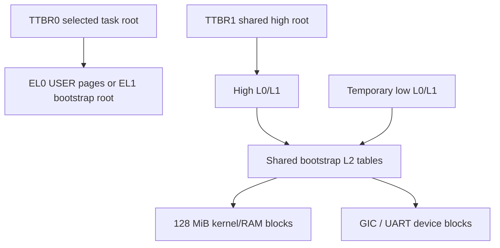

# Memory management

Tyrne boots through temporary identity translation, migrates the EL1 kernel to shared privileged TTBR1, and activates per-task low TTBR0 roots for execution. This chapter describes that live layout, descriptor/flush contracts, the PMM, AddressSpace objects and trusted loader composition. Physical ownership, complete reclamation, kernel section permissions and hostile fault recovery remain separate work.

> **Last verified against:** 2026-10-13; source da18ed5c2a2d8b3d61f82337a9da021d05d73451; owner [T-046](../analysis/tasks/phase-b2/T-046-docs-subsystem-chapters-refresh.md).

## Context

[ADR-0009](../decisions/0009-mmu-trait.md) defines the MMU trait; [ADR-0027](../decisions/0027-kernel-virtual-memory-layout.md) defines bootstrap translation; [ADR-0033](../decisions/0033-kernel-high-half-migration.md) and its dated riders define the realized high half. [ADR-0035](../decisions/0035-physical-memory-manager.md), [ADR-0028](../decisions/0028-address-space-data-structure.md), [ADR-0029](../decisions/0029-initial-userspace-image-format.md) and [ADR-0038](../decisions/0038-mmu-translate-and-user-access.md) govern allocation, AS objects, image loading and user-copy translation. These decisions and actual implementation control this synthesis; old identity-only descriptions apply only to bootstrap.

## Design

### Why a memory-management chapter

Hardware translation is one part of a [capability](../glossary.md) boundary. Current trusted kernel APIs create and map AS objects; no MemoryRegion capability syscall or fault-supervisor service is implemented. Turning translation on can fault before ordinary recovery is available. The [ADR-0027 simulation](../decisions/0027-kernel-virtual-memory-layout.md#simulation) and [boot migration](boot.md#high-half-migration-t-022--adr-0033) describe the crossing rather than treating vector installation as a guarantee that every bad mapping is recoverable.

### Current layout and bootstrap identity translation

Both regimes use 48-bit VA, a 4 KiB granule and four levels. BSP bootstrap uses 2-MiB L2 blocks; ordinary new AS mappings use 4-KiB L3 pages. Low identity translation is temporary. Shared TTBR1 remains active after migration; selected Task roots occupy TTBR0.

The bootstrap low and high paths share the same physical L2 descriptors, while the EL0 image has separate user page tables.

Six pre-zeroed frames (24 KiB) are reserved **inside `.bss`**: four low L0/L1/two L2 frames and two high L0/L1 frames. `__boot_pt_*` symbols name them; `.boot_pt` is not a separate output section. No allocator is needed to enable bootstrap translation. The high L0 entry is 511; high L1 entries 508/509 reach the shared device/RAM L2 tables.

### Identity ranges

These are bootstrap PA spans; the same spans are subsequently reached at high offset + PA. Ranges are half-open.

| Span | Mapping | Count / access |
|------|---------|----------------|
| `0x0800_0000..0x0900_0000` | GIC device window | Eight 2-MiB blocks, privileged RW, PXN/UXN. |
| `0x0900_0000..0x0920_0000` | UART-containing device block | One 2-MiB block; actual PL011 starts at `0x0900_0000`. |
| `0x4000_0000..0x4800_0000` | Normal cached RAM/kernel | 64 blocks, privileged RW/executable, USER clear. |

Kernel RAM is RWX-equivalent; per-section W^X is reserved as ADR-0034 in the [index](../decisions/README.md). For an existing block, the live mapper returns AlreadyMapped from `map`, and BlockMapped from `unmap` or `translate`; it does not automatically split bootstrap blocks into 512 pages. [T-041](../analysis/tasks/phase-b2/T-041-blockmappedmmu-already-mapped.md) owns reconciliation of the older fake with this real-map contract. User image RX and stack RW-NX are separate mappings, not a retrofit of kernel section permissions.

### `MAIR_EL1` attribute encoding

MAIR index 0 is `0x00` device-nGnRnE; index 1 is `0xFF` normal inner/outer write-back cached memory. DEVICE selects index 0; other mappings select index 1. The remaining indices are not a current cache-mode API. RAM descriptors use inner shareability; device descriptors use nonshareable attributes.

### `TCR_EL1` configuration

| Field | Current setting / transition |
|-------|------------------------------|
| T0SZ / T1SZ | 16 / 16: two 48-bit regimes. |
| TG0 / TG1 | `00` / `10`: 4 KiB granules. |
| IRGN/ORGN, SH | Write-back/write-allocate, inner-shareable walks for both regimes. |
| IPS | `010`: 40-bit physical-address encoding, distinct from the direct-map window limit. |
| AS | 0: 8-bit ASID field; current activation uses ASID 0. |
| EPD0 / EPD1 | Bootstrap `(0,1)` → both on `(0,0)` → low off `(1,0)` → selected-task low on `(0,0)`. |

The uniform `0xFFFF_FFFF_0000_0000` offset maps kernel PA `0x4008_0000` at `0xFFFF_FFFF_4008_0000`. Helpers guard the low-4-GiB physical window on the bare-metal build; a larger physical range needs a revised BSP layout, even though TCR's PA encoding is wider. On host builds the offset is zero for real host-backed tests.

### Page-table entry encoding

Pure [`vmsav8` helpers](../../hal/src/mmu/vmsav8.rs) encode table/block/page descriptors and decode translated leaf permissions. L2 blocks use 2-MiB-aligned output PAs; L3 pages use 4-KiB-aligned PAs. Valid/type, AttrIndx, AF and shareability select the appropriate descriptor form.

| Mapping | AP | PXN / UXN |
|---------|----|-----------|
| Privileged RW, not executable | `00` | 1 / 1 |
| Privileged RO, not executable | `10` | 1 / 1 |
| Privileged executable RAM | `00` or `10`, according to WRITE | 0 / 1 |
| USER RW, not executable | `01` | 1 / 1 |
| USER RO executable image | `11` | 1 / 0 |
| DEVICE | According to USER/WRITE flags | 1 / 1 regardless of EXECUTE. |

Read permission is implicit. nG is cleared for GLOBAL and set otherwise; not every mapping is global. AF is set when mapping. NS-bit encoding alone is not a TrustZone/secure-EL1 guarantee. Encoder tests live in the HAL, not a fabricated host-built BSP test module. The trusted map API can accept combinations the current loader never uses; these flags do not enforce physical ownership or a global W^X policy.

### The `MapperFlush` flush-token discipline

`map` returns `Result<MapperFlush, MmuError>`; `unmap` returns the token and removed frame. `flush(mmu)` invalidates the recorded VA; `ignore()` documents deferral for a later bulk invalidation. `#[must_use]` plus the denied unused-result lint catches accidental unused values, but explicit discarding can bypass it. Review still verifies the right MMU/root, invalidation ordering and the correctness of any ignored token.

The mapper allocates intermediate tables through a kernel `FrameProvider`, returns typed failures and keeps existing roots/intermediate tables after leaf unmap. It is neither a heap allocator nor complete AS destruction. [T-040](../analysis/tasks/phase-b2/T-040-mapperflush-asid-discriminant.md) separately owns flush-token AS identity.

### Why two methods (`flush` and `ignore`) instead of just `flush`?

Leaf-by-leaf immediate invalidation is simple; a loader rollback/bulk operation can instead remove several mappings and perform one full invalidation. `ignore()` makes that choice visible, not automatically correct. It does not disable a future invalidation obligation or prove stale translations are inaccessible.

### Boot-time MMU activation sequence

1. Reset establishes EL1, masked DAIF, a stack and zeroed BSS.
2. `kernel_entry` emits low UART diagnostics and installs the low vector address before identity MMU activation.
3. BSP builds low tables, programs translation attributes/registers and enables MMU/caches with required barriers.
4. Build/install high root, enable TTBR1, rebase SP/VBAR and branch PC high.
5. Null/disable TTBR0 and invalidate; construct high console/CPU and capture the elapsed-time origin.
6. Initialize PMM/AS/loader, then GIC/timer support and task bindings; scheduler activation installs the selected root before execution.

A low UART access already occurs before MMU enable. The boot timestamp occurs after high-half hardware construction, not at reset. The table/console mapping must itself work for an exception diagnostic to succeed; no numeric recoverability percentage is asserted.

### Failure-mode inventory

Bad translation registers/descriptors can fault instruction fetch, stack or MMIO. Non-SVC faults reach whole-kernel panic, and a missing vector/console mapping may make even that diagnosis unavailable. Fresh smoke validates the composed trusted boot path, not all descriptor failures, arbitrary PA grants or hardware break-before-make behavior.

## Frame allocation discipline

[`Pmm<N,R>`](../../kernel/src/mm/pmm.rs), delivered by [T-017](../analysis/tasks/phase-b/T-017-physical-memory-manager.md), is a bitmap allocator with a hint and cached reserved spans. QEMU configures `N=4096`, `R=8`, 32,768 frames across 128 MiB. It reserves pre-image RAM and kernel-through-bootstrap-stack storage, including BSS/static stacks and all six table frames. A successful allocation zeroes the full frame. `PhysFrame` construction enforces page alignment before the call; `free_frame` checks the managed extent, reserved ranges and allocation bit.

Initialization runs high after TTBR0 is disabled. [`phys_to_kernel_va`](../../hal/src/mmu/mod.rs) and [`phys_frame_kernel_ptr`](../../kernel/src/mm/mod.rs) are realized helpers, delivered by [T-022](../analysis/tasks/phase-b/T-022-high-half-kernel-mapping.md) under ADR-0033. PMM zero-fill and loader copy route physical frames through the high direct map. The **2026-05-30 Amendments of UNSAFE-2026-0026 and UNSAFE-2026-0027** in the [audit log](../audits/unsafe-log.md) record these address-regime changes; they are not future placeholders.

**Historical evidence (2026-05-14).** T-019-era `tyrne: image loaded (...)` output described the then-placeholder image and first PMM/AS/map composition. That banner is absent today. [Fresh retained debug/release evidence](../analysis/reports/2026-10-13-t045-architecture-verification.md) instead shows real hello/exit, with 175 debug versus 170 release reserved frames at those exact builds. These values and bootstrap-root addresses vary with layout/profile, not the allocator contract.

The PMM's current bitmap access is single-core. Its non-atomic operations cannot be assumed safe when a second core starts; Phase C owns that gate.

## Address-space objects

[`AddressSpace<M>` and its eight-slot arena](../../kernel/src/mm/address_space.rs) wrap BSP root state in generation-checked handles. Slot zero wraps the already populated **low bootstrap root**, even after that root has been temporarily disabled; it is not TTBR1's high root. EL1 A/B/idle activate it with USER-clear mappings. Hello's separately created root maps its user image/stack; shared TTBR1 keeps privileged code reachable across swaps.

`cap_create_address_space` resolves an AddressSpace parent, checks DERIVE, narrowed rights, depth, arena and table capacity **before** root allocation. It creates/wraps the zeroed root, allocates the AS slot and derives a child cap. This is not insert_root and does not have the old capacity-after-allocation leak. It still trusts generic derivation's new-object correlation.

`cap_map`/`cap_unmap` resolve kind/live AS and call the HAL. They do not check MAP/UNMAP rights or PA ownership. These trusted internal helpers are absent from v1 EL0 dispatch; [Phase E](../roadmap/phases/phase-e.md) must harden them with the relevant untrusted exposure.

Task creation stores an AS handle; scheduler registration separately records it and invokes activation before switching. [Task loader](task-loader.md) validates span/budget/source overlap, uses fresh image RX/stack RW-NX frames and frees committed leaves on failure. Root/intermediate-table/AS-slot leaks remain, and task exit does not destroy these resources. High-half helpers solve addressing, not lifecycle reclamation.

## TLB-invalidation scope

Current `activate` installs TTBR0 with ASID 0, clears EPD0, then uses ISB, DSB ISHST, TLBI VMALLE1, DSB ISH and ISB. Per-address invalidation uses VAE1 with completion barriers; full invalidation uses VMALLE1. There is no ASID allocator or complete cross-core shootdown protocol. A future SMP design must revisit semantics/ownership; this chapter does not promise only the implementation body will change.

## Page-fault path

Both kernel and non-SVC EL0 synchronous faults reach panic-class handling. No demand population, COW, TaskFault delivery or supervisor restart is implemented. ADR-0030 is already filed for syscalls and does not secretly provide those mechanisms. Fault supervision/lifecycle remain [Phase E](../roadmap/phases/phase-e.md) work; hardware permission/trap correctness remains [Phase D](../roadmap/phases/phase-d.md).

## Invariants

- Bootstrap table reservations are aligned and zeroed before activation; kernel PC/SP/VBAR are high before freeing low translation.
- Trusted USER mappings are separate from privileged TTBR1; current activation flushes ASID-0 translations before task execution.
- PMM allocation excludes configured reservations and zeroes returned frames under its current single-core ownership contract.
- AS creation checks authority/depth/capacity before root allocation; map/unmap's narrower current enforcement is explicit.
- Mapping mutation needs an intentional flush decision; successful smoke is not a substitute for reviewing that obligation.

## Trade-offs

Shared L2 bootstrap blocks keep tables small while leaving kernel RAM permissions coarse. ASID-0 full invalidation avoids ASID lifecycle complexity at a switching cost. Fixed PMM/AS bounds and trusted loading simplify bring-up, without complete teardown, arbitrary physical grants or SMP protection. The single offset is concrete and auditable but limits future physical layouts.

## Open questions

Physical ownership/derive correlation, AS/object destruction and hostile fault handling precede untrusted memory services. Kernel section permissions, hardware break-before-make/cache maintenance and trap state require their dedicated Phase D work. ASIDs, shootdown and bitmap synchronization belong with Phase C concurrency. T-040 owns token identity; no status is promoted by this refresh.

## Cross-references

- [MMU trait and helpers](../../hal/src/mmu/mod.rs), [descriptor encoders/tests](../../hal/src/mmu/vmsav8.rs).
- [BSP mapper](../../bsp-qemu-virt/src/mmu.rs), [bootstrap](../../bsp-qemu-virt/src/mmu_bootstrap.rs), [linker](../../bsp-qemu-virt/linker.ld).
- [Boot](boot.md), [HAL](hal.md), [exceptions](exceptions.md), [scheduler](scheduler.md), [security model](security-model.md).
