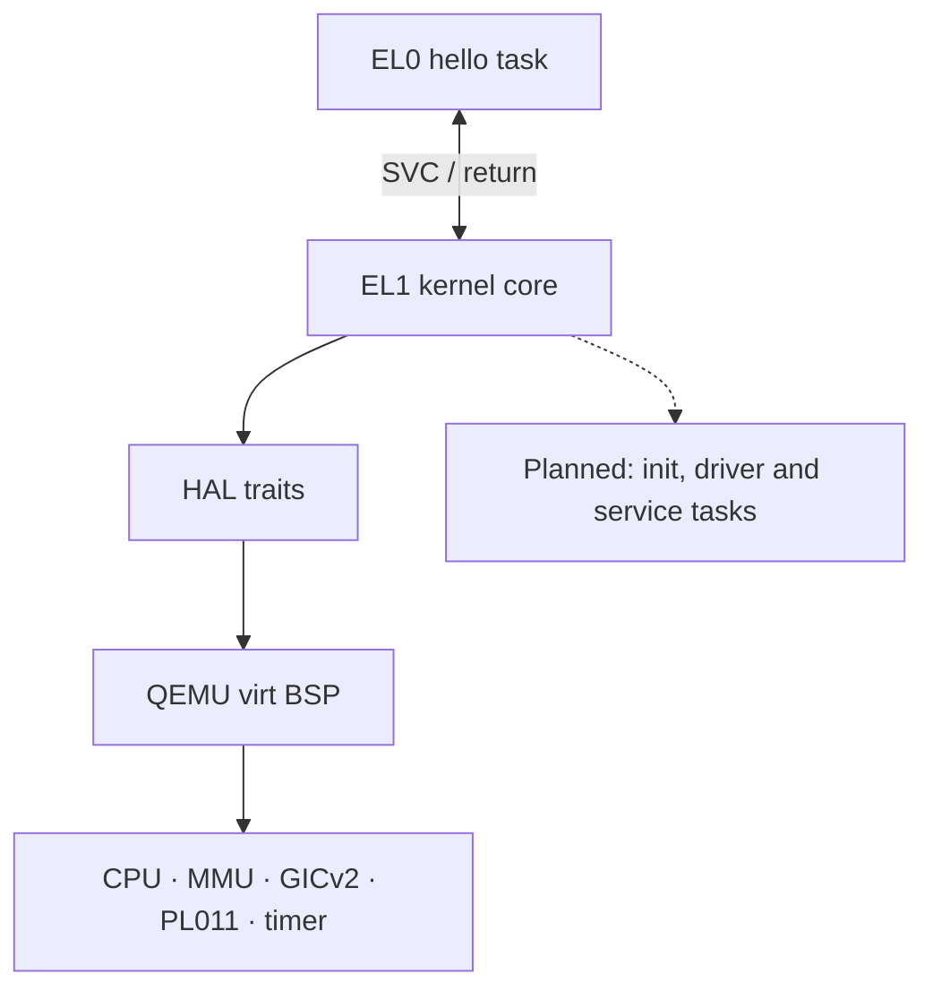
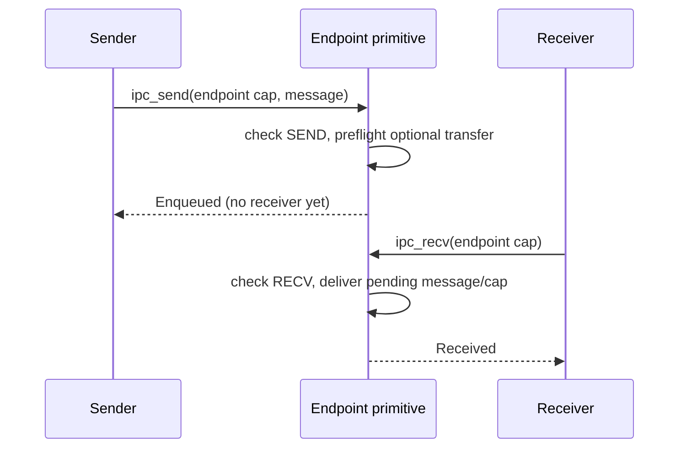

# Architecture overview

Tyrne is a [capability](../glossary.md)-based microkernel. This chapter introduces the running QEMU `virt` aarch64 system: the kernel core, HAL and BSP, the first EL0 userspace task, and the boot, IPC and syscall paths between them. It distinguishes that implementation from the planned userspace service architecture; follow the linked subsystem chapters for details.

> **Status (2026-10-13).** Phase B closed on 2026-06-01. The kernel runs the first real EL0 `hello` task through the v1 syscall boundary alongside the EL1 two-task IPC demo. Phase B.2 is active; Phase C is next and remains gated by B.2's exit criteria. See [current focus](../roadmap/current.md).

> **Last verified against:** 2026-10-13; source `4ad0b3d8a9d43310fcd937013131bffadcc803d7`; owner [T-045](../analysis/tasks/phase-b2/T-045-docs-overview-taskloader-arch-index.md).

## Context

[ADR-0001: Capability-based microkernel architecture](../decisions/0001-microkernel-architecture.md) puts capabilities, scheduling, IPC, memory and interrupt mechanisms in the kernel, with services intended for userspace. [ADR-0002: Rust as the implementation language](../decisions/0002-implementation-language-rust.md) and [ADR-0004: Target platforms](../decisions/0004-target-platforms.md) establish Rust and QEMU `virt` aarch64 as the implementation and primary development target. Raspberry Pi 4 is the first planned hardware target; its BSP has not landed.

The implementation is pre-alpha. Privilege separation and authority checks are present on specific paths, but this is not a production isolation guarantee. In particular, arbitrary untrusted image loading, fault containment, full resource reclamation and SMP are not implemented. [SECURITY.md](../../SECURITY.md) describes the current boundary and limitations.

## Design

### Top-level layers

The BSP implements the HAL traits and wires the portable kernel to hardware. Solid edges below describe the running system; the dotted service branch is planned.



The kernel crate depends on HAL traits, not on a BSP crate. The BSP supplies boot assembly, hardware implementations, exception/syscall glue and demo setup. PL011, GICv2 and timer support currently run privileged; moving general device services into userspace is a design goal, not a description of all present drivers.

### What the kernel does

1. **Capabilities.** Kernel-owned tables name typed, generation-checked objects and carry rights. Internal APIs support derivation, copying with authority, revocation and transfer. `Capability` is neither `Copy` nor `Clone`; copying authority requires the table API. These internal APIs are not all EL0 syscalls.
2. **Scheduling.** A single-core cooperative FIFO scheduler switches contexts on explicit yield, blocking through the EL1 IPC bridge, or task exit. There is no priority scheduler or timer-driven preemption. See [`scheduler.md`](scheduler.md).
3. **IPC.** Depth-one endpoints hold messages and an optional transferred capability; independent notification objects accumulate bits. The primitive APIs, EL1 scheduling wrappers and EL0 syscall behavior have different completion semantics, described below. See [`ipc.md`](ipc.md).
4. **Memory.** The PMM allocates frames; address-space objects and MMU implementations install translations. Creating or dropping a capability is distinct from reclaiming the entire underlying address space. See [`memory-management.md`](memory-management.md) and [`task-loader.md`](task-loader.md).
5. **Interrupts.** Exception vectors dispatch the current GICv2/generic-timer IRQ path. The timer IRQ does not preempt tasks or deliver a userspace IRQ service. See [`exceptions.md`](exceptions.md).

Filesystems, network stacks, service supervision and a shell are future userspace responsibilities. The current kernel does not provide those services.

### What the HAL does

The HAL provides the interfaces the portable core needs; concrete board support lives in `bsp-qemu-virt`. The current traits are `Cpu` (IRQ state, barriers, core identity and halt), `ContextSwitch` (context initialization and switching), `Mmu` (translation operations), `IrqController`, `Timer` and `Console`. `ContextSwitch` is separate from `Cpu` per [ADR-0020](../decisions/0020-cpu-trait-v2-context-switch.md). An empty `Iommu` placeholder does not supply DMA isolation.

The current BSP uses QEMU `virt` with GICv2, PL011 and the aarch64 generic timer. GICv3 and Raspberry Pi 4 support remain future work. [`hal.md`](hal.md) expands the trait boundary; source definitions are in [`hal/src/`](../../hal/src/).

### What userspace looks like

The running userspace program is a trusted, BSP-embedded `hello` image, built from [`userland/hello/`](../../userland/hello/) under [ADR-0039](../decisions/0039-userland-build-pipeline.md). It has its own image/stack mappings, a kernel-owned capability table and a per-task EL1 kernel stack. The `Task` object holds identity and an address-space handle; execution context is held separately by the scheduler. No multi-threaded process model is exposed.

The BSP seeds a debug-console capability for this task. `hello` attempts `console_write` and then exits; the greeting appears only in debug builds. It is not an init service and does not spawn drivers. Init, service graphs, supervisors, general shared-memory grants and an untrusted image-loading interface are planned. No `MemoryRegionCap`-based mapping interface is exposed to EL0 today.

### Boot flow

The executable path is [`boot.s`](../../bsp-qemu-virt/src/boot.s), [`kernel_entry` / `kernel_main_high`](../../bsp-qemu-virt/src/main.rs), and the scheduler's [`add_user_task`](../../kernel/src/sched/mod.rs). The sequence below summarizes the current single-core path. [`boot.md`](boot.md) receives its detailed chapter refresh under [T-046](../analysis/tasks/phase-b2/T-046-docs-subsystem-chapters-refresh.md), which also rechecks this summary.

```mermaid
sequenceDiagram
    participant Reset as BSP reset assembly
    participant BSP as BSP Rust setup
    participant S as Cooperative scheduler
    participant U as EL0 hello
    Reset->>Reset: mask DAIF, drop EL2 to EL1 if needed
    Reset->>Reset: set stack, enable FP/SIMD, zero BSS
    Reset->>BSP: kernel_entry (MMU initially off)
    BSP->>BSP: install vectors, enable bootstrap identity MMU
    BSP->>BSP: activate TTBR1, move PC/SP/VBAR high, disable TTBR0
    BSP->>BSP: initialize PMM, wrap bootstrap AS, load hello
    BSP->>BSP: configure GIC/timer, mint Task, seed caller table
    BSP->>S: register EL1 B/A, EL0 hello and idle fallback; start
    S->>U: activate task TTBR0, restore prepared context, ERET
    U->>BSP: attempt console_write, then task_exit (SVCs)
    BSP->>S: terminate current userspace task
    S->>S: finish remaining demo work; Task A spins
```

The BSP publishes the fail-closed empty caller table before starting scheduling and binds the real table/window to the current EL0 task. The EL1 IPC tasks and EL0 task interleave; the diagram does not require both EL1 tasks to finish before EL0 entry. There is no `BootInfo` handoff or userspace init/config parser in this path.

The translation split follows [ADR-0027](../decisions/0027-kernel-virtual-memory-layout.md), [ADR-0033](../decisions/0033-kernel-high-half-migration.md) including its single-offset revision notes, and [ADR-0028](../decisions/0028-address-space-data-structure.md). The trusted loading and task wiring are described in [`task-loader.md`](task-loader.md); [ADR-0037](../decisions/0037-el0-entry-context.md) governs EL0 entry; [ADR-0038](../decisions/0038-mmu-translate-and-user-access.md) defines USER-checked translation for syscall buffers.

### IPC

The kernel primitives in [`kernel/src/ipc/mod.rs`](../../kernel/src/ipc/mod.rs) check the endpoint capability and its `SEND` or `RECV` right. `ipc_send` returns `Delivered` when a receiver is waiting, otherwise `Enqueued`; a busy depth-one slot is an error. `ipc_recv` returns a message when available, otherwise registers a receiver and returns `Pending`. These primitive calls do not themselves block the scheduler.

This example shows primitive completion, also used by the EL0 dispatcher, without implying a blocking syscall:



The EL1 scheduler bridge in [`kernel/src/sched/mod.rs`](../../kernel/src/sched/mod.rs) adds cooperative behavior: receive blocks on `Pending`, resumes and consumes the completed receive; send unblocks/yields on `Delivered`, while `Enqueued` returns without switching. The EL0 dispatcher calls the bare primitives and returns encoded outcomes; it does not call these blocking bridge wrappers. [ADR-0017](../decisions/0017-ipc-primitive-set.md), [ADR-0021](../decisions/0021-raw-pointer-scheduler-ipc-bridge.md) and [ADR-0031](../decisions/0031-initial-syscall-set.md) provide the corresponding decisions.

Capability transfer has two stages. Send validates source authority and endpoint-slot availability before moving the capability from the sender's table into endpoint state. Receive checks the receiver's table capacity before installing it; a full table leaves the pending message/capability in the endpoint for a later receive. Notification objects are separate from endpoints and have kernel APIs, but no notification syscall is in v1. Userspace IRQ notification delivery is also future work.

### Address spaces

[ADR-0028](../decisions/0028-address-space-data-structure.md) defines the `AddressSpace<M>` object. A userspace task's low mappings use its own `TTBR0_EL1` root; the privileged kernel remains under the shared `TTBR1_EL1` root rather than being copied into each userspace root. Kernel mappings deny EL0 access. The current fixed offset is `0xFFFF_FFFF_0000_0000`; physical kernel image base `0x4008_0000` therefore maps at `0xFFFF_FFFF_4008_0000`. This single-offset arrangement covers the v1 physical range below 4 GiB, not arbitrary future physical addresses. See [ADR-0033's revision notes](../decisions/0033-kernel-high-half-migration.md).

The current [`QemuVirtMmu::activate`](../../bsp-qemu-virt/src/mmu.rs) uses ASID 0 and flushes translations on root swaps, implementing [ADR-0028](../decisions/0028-address-space-data-structure.md). [ADR-0035](../decisions/0035-physical-memory-manager.md) supplies the allocator. `cap_create_address_space` checks derivation authority and narrowing; current `cap_map` / `cap_unmap` resolve an AddressSpace capability by kind but do not enforce per-operation MAP rights or a physical-memory ownership capability. They remain trusted kernel APIs. That hardening is required before exposing memory operations to untrusted callers in [Phase E](../roadmap/phases/phase-e.md).

The loader installs userspace image pages read/execute and stack pages read/write, non-executable. This does not mean the whole kernel enforces W^X: the current high-half RAM mapping is RWX-equivalent. Kernel section permissions are reserved under [ADR-0034](../decisions/README.md).

### Interrupts

The BSP's current-EL IRQ entry saves context and acknowledges through `IrqController`. The recognized generic-timer path masks its source, performs EOI and returns; a spurious interrupt returns without EOI, and any other nonspurious IRQ is EOI'd before panic. This infrastructure and the idle/WFI fallback are installed, but the default demo arms no timer deadline and ends in Task A's spin loop. The retained traces exercise neither timer IRQ delivery nor idle/WFI. The handler does not look up a userspace `IrqCap`, schedule a driver, or implement an EL0 `irq_eoi` call. Those are planned device-service mechanisms; scheduling remains cooperative.

### Syscall surface

The v1 register ABI uses `x8` for the number, `x0`–`x5` for arguments, and `x0` for return status with payload in `x1`–`x7`; see [ADR-0030](../decisions/0030-syscall-abi.md), [ADR-0031](../decisions/0031-initial-syscall-set.md), [`abi.rs`](../../kernel/src/syscall/abi.rs) and [`dispatch.rs`](../../kernel/src/syscall/dispatch.rs).

| Number | Call | Current authority / behavior |
|--------|------|------------------------------|
| 1 | `ipc_send` | Endpoint capability with `SEND`; returns primitive outcome. |
| 2 | `ipc_recv` | Endpoint capability with `RECV`; returns message or `Pending`. |
| 3 | `task_yield` | Acts on the current caller only; no capability argument. Fails closed without a current task. |
| 4 | `task_exit` | Terminates the current caller without returning; no capability argument. Fails closed without a current task. |
| 5 | `console_write` | Recognized only with `debug_assertions`; requires `DebugConsole` / `CONSOLE_WRITE`, then validates the user range and USER mappings before output. |

Number 5 is rejected as `BadSyscallNumber` in normal release builds before capability lookup or output. The other internal task, address-space, capability and IRQ APIs are not additional syscalls. BSP binding obtains the registered table/window from the current scheduler slot and generation-resolves its AddressSpace handle. Missing table/window or failed AS resolution selects an empty table/window and disables current-task control effects. This path relies on trusted scheduler registration and lifetimes; it does not separately validate the current Task generation or table-pointer identity.

The syscall input checks do not contain arbitrary EL0 execution faults: a non-SVC synchronous fault currently panics the whole kernel. `task_exit` removes the task from scheduling but does not reclaim all Task/AS/capability resources. These limits matter before untrusted userspace or repeated task creation is introduced; see [SECURITY.md](../../SECURITY.md).

## Invariants

These claims describe the current bounded paths, not a general assurance certificate:

- Endpoint operations validate object identity, capability kind and the required `SEND` / `RECV` right before message state changes.
- Capability tables remain kernel-owned; `Capability` cannot be duplicated through Rust `Copy` / `Clone`.
- The real `hello` image executes at EL0 with its own low mappings, while exception handling remains in the privileged high half.
- Debug-console output requires both recognition of syscall 5 and its capability/buffer checks; normal release rejects that number.
- User-buffer copying uses checked USER mappings rather than directly dereferencing an unchecked userspace pointer.
- Scheduling is single-core and cooperative; IRQ delivery alone does not preempt the current task.
- No proprietary binary firmware or driver is linked into the kernel.

## Trade-offs

- Fixed-capacity arenas and a trusted embedded image keep the first boot path small, but do not provide general process creation, supervision or reclamation.
- ASID 0 plus full root-swap invalidation simplifies the current translation model at a cost to future switching performance.
- Privileged board drivers are sufficient for boot and diagnostics; the intended userspace driver model needs additional authority and IRQ interfaces.
- Capability-based interfaces require explicit authority design. Existing kind-only memory helpers and fail-stop paths need hardening before wider exposure.

## Open questions

- Reply-capability/call operations beyond the accepted v1 IPC set; any extension needs its own decision.
- General image format, writable sections and safe untrusted loading before a richer userspace runtime.
- Fault containment, supervision, complete task/address-space reclamation and physical-memory authority.
- Userspace async runtime and service composition.
- SMP scheduling, synchronization and hardware BSPs after their roadmap gates open.

## References

- [Architecture index](README.md) — chapter coverage and verification convention.
- [Architectural principles](../standards/architectural-principles.md) — goals and required design discipline.
- [Glossary](../glossary.md) — project terminology.
- [T-045 source and runtime verification](../analysis/reports/2026-10-13-t045-architecture-verification.md) — exact source baseline, retained debug/release traces and manual exception inspection.
