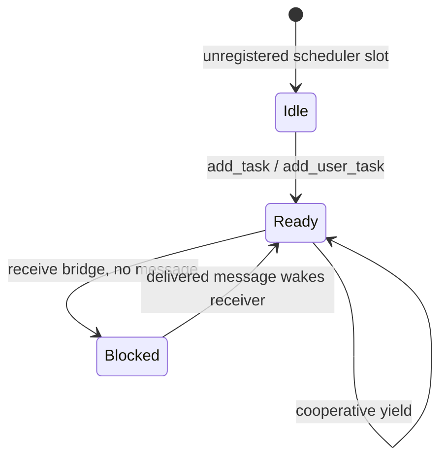
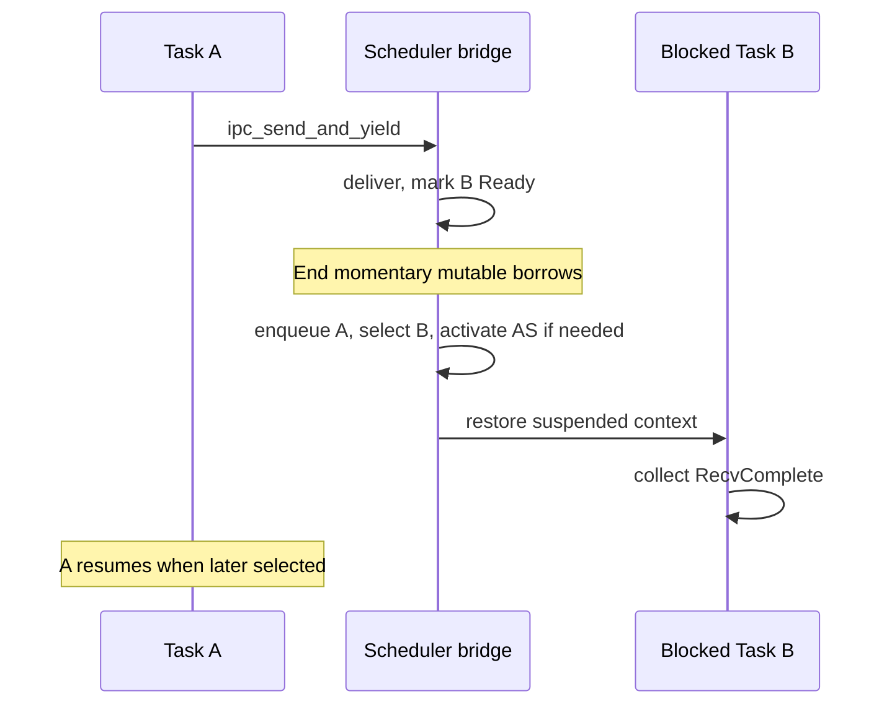

# Scheduler design

Tyrne's scheduler is single-core, cooperative and FIFO. It owns per-slot saved contexts and registration bindings, dispatches EL1 demo tasks and a real EL0 task, and switches through a raw-pointer bridge whose temporary mutable references end before the architectural switch. This chapter describes that current composition, including idle fallback, address-space activation and non-reclaiming task exit.

> **Last verified against:** 2026-10-13; source da18ed5c2a2d8b3d61f82337a9da021d05d73451; owner [T-046](../analysis/tasks/phase-b2/T-046-docs-subsystem-chapters-refresh.md).

## Context

[ADR-0019](../decisions/0019-scheduler-shape.md) fixes bounded FIFO scheduling; [ADR-0020](../decisions/0020-cpu-trait-v2-context-switch.md) defines the HAL context primitive; [ADR-0021](../decisions/0021-raw-pointer-scheduler-ipc-bridge.md) explains the borrow discipline. [ADR-0022](../decisions/0022-idle-task-and-typed-scheduler-deadlock.md) retains typed deadlock handling, while [ADR-0026](../decisions/0026-idle-dispatch-fallback.md) replaces FIFO-resident idle with a separate fallback slot. [Capabilities](../glossary.md) identify kernel objects; scheduler registration is an additional trusted kernel operation, not an EL0 task-creation syscall.

## Design

### Data structure

[`Scheduler<C: ContextSwitch + Cpu>`](../../kernel/src/sched/mod.rs) holds a bounded ready FIFO and parallel arrays indexed by the 16 Task slots. A Task's object identity and its saved CPU context are separate: the Task arena stores the object; the scheduler stores `C::TaskContext`.

| Field | Meaning |
|-------|---------|
| `ready` | Up to TASK_ARENA_CAPACITY queued handles; current is normally absent. |
| `task_states`, `task_handles` | Registration state and cached handle per slot. |
| `task_address_space_handles` | Per-slot AS used by activation. |
| `task_cap_tables` | Registered raw table pointers for EL0 caller binding. |
| `task_user_windows` | Registered user-range bounds for copy validation. |
| `contexts` | Opaque BSP saved state per slot. |
| `current` | Running handle; None before start and in a receive-transition window. |
| `idle` | Dedicated fallback handle, outside the FIFO. |

The EL1 A/B/idle tasks use the bootstrap low root; EL0 hello has its own user root. The kernel remains in shared privileged TTBR1. This is no longer a shared-address-space-only demo. [ADR-0028](../decisions/0028-address-space-data-structure.md) governs activation; [ADR-0033](../decisions/0033-kernel-high-half-migration.md) governs the split.

### Lifecycle of a task slot

Registration and receive blocking use the following states. Exit stops dispatching a task but does not implement a transition back to an empty slot.

`Idle` is the state sentinel, not the idle task. `Ready` includes queued and currently executing tasks. `add_task` initializes context, then enqueues, then records registration arrays. Context storage can already have changed if enqueue fails; it is not a universally mutation-free error path. Correct trusted registration avoids duplicate/stale handles and preserves the fixed-capacity queue invariant.

`add_user_task` additionally takes the AS handle and caller table pointer, initializes EL0 context/window and binds the kernel stack. It is live through [T-023](../analysis/tasks/phase-b/T-023-el0-entry-context.md), [T-024](../analysis/tasks/phase-b/T-024-task-create-from-image.md) and [T-028](../analysis/tasks/phase-b/T-028-el0-userspace-wireup.md), running the image built under [ADR-0039](../decisions/0039-userland-build-pipeline.md). The table, contexts and aligned stacks must remain live for registration's lifetime. Debug alignment assertions do not replace this unsafe caller contract.

Current-task accessors read the current slot's registered AS/table/window. BSP syscall entry generation-resolves the AS and fails closed on incomplete binding, but it does not independently check Task generation or table-pointer identity. Trusted registration/lifetimes are load-bearing; see [overview](overview.md#syscall-surface).

`unblock_receiver_on(ep)` scans the bounded state array and queues the first matching blocked receiver. Depth-one IPC supplies the single-waiter discipline.

### Idle task and structural non-emptiness

`register_idle` installs a fallback context and handle. Selection uses `ready.dequeue().or(s.idle)`; idle never takes a FIFO turn ahead of ready work and has no numeric priority. Its entry repeatedly executes WFI, then yields, without explicitly unmasking IRQs. First dispatch holds an IrqGuard on an abandoned caller frame; the cooperative switch does not restore DAIF. Boot's earlier DAIF.I clear therefore does not establish unmasked idle entry. Mask state and actual delivery still need verification before claiming idle wake. IRQ infrastructure exists, but the default demo arms no deadline and ends in Task A's busy-spin; retained smoke does not exercise idle/WFI or timer wake.

Without a ready task or idle, `start` panics as a boot programming error. The receive bridge returns `SchedError::Deadlock` when blocking would leave no dispatch target; it rolls back current/state and cancels the just-registered endpoint receive. These defensive paths remain tested even though the normal BSP registers idle. Registration and queue invariants, rather than a universal panic-free claim, explain normal dispatch.

### `ContextSwitch` and `Cpu`

The scheduler asks `Cpu` to mask/restore IRQ state and `ContextSwitch` to save/restore opaque contexts. QEMU preserves the cooperative ABI's callee-saved GPRs and lower `d8`–`d15`. When a task is selected later, its suspended `context_switch` call returns into that same task. First dispatch instead consumes the seeded EL1 entry or EL0 ERET trampoline.

The scheduler calls an `activate_address_space: impl FnOnce(AddressSpaceHandle)` hook before switching when the selected AS requires it; first dispatch activates its selected root. QEMU installs TTBR0, clears EPD0 and invalidates ASID-0 translations. The EL0 trampoline does not install its own root. See [HAL](hal.md) and [memory management](memory-management.md).

### The raw-pointer bridge

These unsafe free functions take a raw scheduler pointer; actual signatures also include the CPU and address-space activation callback. IPC wrappers additionally take distinct endpoint/queue/table pointers and IPC arguments.

| Function | Behavior |
|----------|----------|
| `start` | First dispatch through a temporary bootstrap context; non-returning. |
| `yield_now` | Re-enqueue current, select next/fallback, activate if needed and switch; NoCurrentTask is typed. |
| `task_exit_current` | Select and run next/fallback without re-enqueueing current; non-returning. |
| `ipc_send_and_yield` | Delivered wakes receiver and yields; Enqueued returns without switching. |
| `ipc_recv_and_yield` | Attempt receive; Pending blocks, dispatches, then collects on resume; Deadlock rolls back. |
| `start_prelude` | Private selection/state helper exercised by host tests. |

Each helper materializes mutable references only inside bounded lexical blocks, ending before a switch. The pointer owners must supply valid, distinct storage and must not retain conflicting references. [UNSAFE-2026-0013/0014](../audits/unsafe-log.md) cover BSP pointer acquisition and momentary borrowing; Removed UNSAFE-2026-0012 records the earlier unsound receiver pattern. Existing Miri tests exercise host paths, not the complete assembly or all possible future interleavings.

`task_exit_current` abandons the exiting syscall frame and replaces current. The old slot can still be Ready in metadata; Task/AS/table/frames are not destroyed. There is no general destroy-to-Idle lifecycle here. Kernel `task_exit` logs and dispatches away; arbitrary EL0 execution faults still panic the kernel, rather than reaching a supervisor.

### Two-task dispatch trace

The EL1 bridge combines endpoint delivery and scheduling, while the v1 EL0 dispatcher calls bare IPC primitives and returns their outcomes.

In actual boot, B is registered before A, followed by EL0 hello and the separate idle fallback. A/B exchange one request/reply around hello's console/exit SVCs. Task B's final yield leaves Task A to print completion/elapsed and spin without yielding. [Fresh retained evidence](../analysis/reports/2026-10-13-t045-architecture-verification.md) confirms that composition, without proving all dispatch/error paths.

## Invariants

- Under valid single-core registration, ready work takes precedence over the separate idle fallback.
- Running/queued tasks use Ready metadata; receive-blocked tasks name their endpoint.
- No live mutable scheduler/IPC reference spans the architectural switch.
- The next task's registered AS is active before user execution or resumed task memory access.
- Receive Deadlock restores scheduler state and the endpoint's pending-receive registration; it does not imply every API error leaves every backing array unchanged.
- Exit does not re-enqueue the exiting task; resource reclamation is a separate unimplemented lifecycle.

## Trade-offs

A non-yielding task starves cooperative work; IRQ infrastructure does not make scheduling preemptive. Fixed arrays and scans bound metadata work but limit scale. Raw-pointer bridges avoid a borrow spanning a context switch and require disciplined trusted callers. Per-slot registration is simple, but lifecycle reuse and atomic identity need additional work before hostile loading/preemption/SMP.

## Open questions

[Phase C](../roadmap/phases/phase-c.md) owns priorities/preemption/SMP and the atomic caller-binding checkpoint before C2/C3. Object destruction and exit reclamation need their lifecycle decision; [Phase E](../roadmap/phases/phase-e.md) owns untrusted capability/service exposure. Multiple waiters and wake policy need a revised IPC/scheduling contract. Existing 4 KiB SP_EL1 stacks need the separately tracked high-water check before IRQ-rich execution.

## References

- [IPC](ipc.md), [exceptions](exceptions.md), [boot](boot.md), [task loader](task-loader.md).
- [Scheduler source and tests](../../kernel/src/sched/mod.rs), [BSP composition](../../bsp-qemu-virt/src/main.rs), [CPU context implementation](../../bsp-qemu-virt/src/cpu.rs).
- [ADR-0037](../decisions/0037-el0-entry-context.md), [ADR-0038](../decisions/0038-mmu-translate-and-user-access.md), [ADR-0031](../decisions/0031-initial-syscall-set.md).

## Revision notes

**2026-10-13 reconciliation.** The current body now describes the fallback, live EL0/AS bindings and non-reclaiming exit. The unchanged dated paragraph below is historical: its “body above is partially stale” observation referred to the document as it stood on 2026-05-06, not this refreshed body.

- **2026-05-06 — Idle dispatch shape changed by [ADR-0026](../decisions/0026-idle-dispatch-fallback.md); body above is partially stale.** The first end-to-end QEMU smoke surfaced an idle-dispatch hang inherited from T-007 / ADR-0022 Option A: round-robin FIFO selected idle ahead of a just-unblocked receiver. ADR-0026 supersedes ADR-0022's Option A with Option B — idle now lives in a dedicated `Scheduler::idle: Option<TaskHandle>` fallback slot, registered via [`register_idle`](../../kernel/src/sched/mod.rs) (not `add_task`). The dispatcher's chain is `ready.dequeue().or(s.idle)`; idle is consulted only when the ready queue is empty. T-014 implemented this fix; the post-fix smoke produces the full `tyrne: all tasks complete` trace at HEAD. The §"Idle task and structural non-emptiness" subsection above and lines like *"every `yield_now` that would otherwise see an empty queue instead dispatches idle"* describe ADR-0022's pre-fix shape; the *behaviour* described (idle fills the empty-queue gap, `SchedError::Deadlock` is a defensive return) still holds, but the *mechanism* is now the dispatcher's `or(s.idle)` chain rather than idle being a FIFO resident. ADR-0022's *typed-error* axis (Option G) is unchanged. See the [B1 smoke-regression mini-retro](../analysis/reviews/business-reviews/2026-05-06-B1-smoke-regression.md) for the incident report and ADR-0026 §Decision outcome's queue-state simulation table for the post-fix flow walkthrough.
