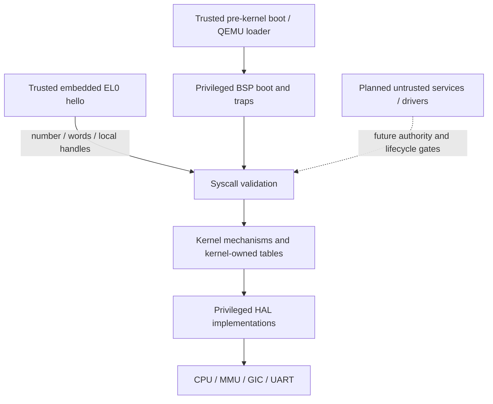

# Security model

Tyrne aims to isolate mutually distrustful tasks through small privileged mechanisms, capability authority and explicit memory boundaries. The current pre-alpha implements a bounded single-core system with a trusted embedded EL0 image, capability-gated IPC/debug console and separate user translation. This chapter distinguishes those mechanisms from the hostile-workload, fault-supervision, resource-lifecycle and hardware protections that remain future work.

> **Last verified against:** 2026-10-13; source da18ed5c2a2d8b3d61f82337a9da021d05d73451; owner [T-046](../analysis/tasks/phase-b2/T-046-docs-subsystem-chapters-refresh.md).

## Context

[ADR-0001](../decisions/0001-microkernel-architecture.md) and [architectural principles](../standards/architectural-principles.md) establish least authority, small TCB, Rust memory safety, userspace services and no proprietary blobs in the build. [ADR-0014](../decisions/0014-capability-representation.md) and [ADR-0016](../decisions/0016-kernel-object-storage.md) define the current capability/object representation. [SECURITY.md](../../SECURITY.md) states the supported pre-alpha boundary and disclosure policy; this document does not confer a production security guarantee.

## Design

### Threat model

#### Adversaries we defend against

The architectural target is a compromised userspace component attempting to access foreign memory, impersonate authority, abuse IPC, corrupt the kernel or compromise unrelated services. Current implemented defenses cover specific entry paths: handle/kind/right validation, user-range/page checks, initial EL0 register scrub and hardware USER permissions on the trusted image's mappings. These are meaningful mechanisms, not evidence that arbitrary hostile binaries or all planned services can be safely hosted today.

#### Assumed attacker capabilities

An EL0 caller can choose syscall numbers/register payloads, fabricate handle bits and attempt invalid user ranges. The decoder exposes only send, receive, self-yield, self-exit and debug-only console. The BSP chooses the current slot's registered table/window and generation-resolves its AS; incomplete binding fails closed. It does not independently revalidate Task generation/table-pointer identity. Current trusted registration and lifetimes remain part of the boundary.

The only loaded image is built from in-tree Rust and embedded by the BSP. There is no arbitrary-image or physical-memory-management service. Before untrusted loading/service exposure, the [Phase E](../roadmap/phases/phase-e.md) ownership, derive-correlation, mapping and lifecycle work must accompany the relevant exposure; [Phase C](../roadmap/phases/phase-c.md) has earlier prerequisites where richer scheduling would expose those assumptions.

#### Adversaries we do not defend against

Current code does not promise hostile-workload availability: a cooperative task can loop without yielding; a non-SVC EL0 synchronous fault panics the whole kernel; exit retains resources. Physical attacks, malicious pre-kernel firmware, speculative/cache side channels and compromised platform hardware are outside demonstrated protection. No IOMMU implementation provides DMA isolation. [ADR-0036](../decisions/0036-qemu-virt-gicv2-no-iommu-v1.md) fixes QEMU's no-IOMMU v1 and defers SMMUv3. Later platforms need explicit firmware/DMA support and honest release boundaries, rather than inheriting a QEMU assurance.

### Trust boundaries

The current privileged BSP/kernel owns tables, object arenas, mappings, context stacks and trap entry. User code receives handle values and user mappings, never a mutable kernel capability table.

TTBR1 keeps shared kernel mappings privileged; each user task uses its own TTBR0. `copy_from_user`/`copy_to_user` check the registered range and every translated page's USER flag before copying via the kernel direct map. That validation is necessary but not a substitute for physical-frame ownership: trusted `cap_map`/`cap_unmap` currently check kind/live AS, without operation-specific MAP rights or ownership checks. The loader creates fresh zeroed image/stack frames and does not accept an arbitrary untrusted ELF service request.

### Capabilities

#### Why capabilities — the confused deputy problem

A [capability](../glossary.md) ties a kernel object's identity to explicit rights in the caller's table. Endpoint and console operations validate that authority before effects instead of treating a name or global current resource as permission. Self-yield and self-exit deliberately name only the bound current task and take no object-capability argument, under [ADR-0031](../decisions/0031-initial-syscall-set.md).

#### What a capability is, at the implementation level

[`Capability`](../../kernel/src/cap/mod.rs) stores rights and `CapObject`; it is neither Copy nor Clone. `CapObject` is a Copy/Clone discriminated identity, not an independently invocable grant. User-visible `CapHandle` packs a table index and generation; the kernel resolves it within the selected subject's table. A forged/stale handle does not create a table entry. Kernel constructors/root insertion and object-management APIs remain trusted; type privacy alone is not an authorization barrier against kernel code.

Capability/CapObject Debug redact object identity. This is not a blanket claim that all handles, rights, addresses or pre-existing diagnostics are secret-free.

#### Capability types (initial set)

**Implemented (v1)** — verified against `CapObject` and [`CapRights`](../../kernel/src/cap/rights.rs):

| Kind | Current operation authority |
|------|-----------------------------|
| Task | Kind identifies the Task; self-yield/exit use current identity, not TaskControl/Kill/Inspect bits. |
| Endpoint | SEND and RECV; TRANSFER applies to a capability being transferred. |
| Notification | NOTIFY; no WAIT bit or EL0 notify/wait syscall. |
| AddressSpace | Creation checks parent DERIVE and rights subset; current trusted map/unmap resolve kind/live object, with no MAP/UNMAP bits. |
| DebugConsole | CONSOLE_WRITE, checked only for a recognized debug console syscall. |

Common table operations use DUPLICATE, DERIVE and REVOKE; TRANSFER gates IPC movement. Those four plus SEND, RECV, NOTIFY and CONSOLE_WRITE are the eight current rights. No other rights from the old “typical rights” table are implemented.

**Planned / unresolved** — these are roadmap mechanisms, not current enum variants or settled syscall signatures:

| Concept | Authority / decision ownership |
|---------|--------------------------------|
| MemoryRegion / physical-frame grants | Physical ownership and untrusted mapping contract in Phase E. |
| IRQ grants / driver notification | IRQ and userspace-driver work in Phases C/D/E; current GIC access is privileged BSP code. |
| IOMMU mappings | Deferred SMMUv3 work under ADR-0036; empty HAL placeholder today. |

Earlier TimerCap, CapTableCap, DuplicateCap and RevokeCap names were design candidates, not filed current kinds. Their dedicated rights/signatures have no allocated implementation contract. Duplication/revocation currently use rights on an existing capability, not separate authority-object kinds. This distinction preserves the planning question without advertising invented APIs.

#### Capability operations

| Operation | Current table semantics |
|-----------|-------------------------|
| `cap_copy` | Requires DUPLICATE, narrows rights and copies the same object into a peer/sibling, or another root if the source is root. |
| `cap_derive` | Requires DERIVE, rights subset, depth/capacity; installs a child carrying the caller-supplied new_object. |
| `cap_revoke` | Requires REVOKE; removes descendants in this table and keeps the source capability. |
| `cap_drop` | Removes a leaf; HasChildren rejects an interior node. No separate DROP right. |
| `cap_take` | Removes a leaf and returns the value; IPC separately validates TRANSFER before calling it. |

Generic `cap_derive` does **not** correlate the new object's kind, scope or identity with its parent. It is a trusted kernel API today. Rights narrowing alone is not physical subregion/authority correlation; Phase E hardening must precede exposing derivation to untrusted callers. Table-local revoke is bounded cooperative traversal, not an SMP or cross-table revocation proof.

#### Capability derivation tree

The CDT tracks parent/first-child/next-sibling indices within a 64-slot table, with maximum derivation depth 16. Authorized copying makes a peer; derivation makes a child. Revoking the child tree leaves the source and independent peers intact. Slot generation invalidates removed handles; it is distinct from the target object's arena generation.

#### Badges

No badge field or kernel stamp exists. `Message::label` remains caller-controlled, per the formal deferral in [ADR-0018](../decisions/0018-badge-scheme-and-reply-recv-deferral.md). A server must not treat that label as authenticated sender identity. A future badge scheme requires its own contract and service evidence.

### Authority transfer over IPC

One optional leaf capability moves from sender table to endpoint state after source/endpoint preflight. Receive separately checks capacity before consuming pending authority and installs it as a new local root. Full receive tables preserve the pending message/cap for retry. This is move-only value transfer, not uniqueness of all authority instances; explicit cap_copy can create peers.

New roots break cross-table CDT ancestry. Sender revoke cannot revoke the transferred root; see [ADR-0023](../decisions/0023-cross-table-capability-revocation-policy.md) for the deferred decision and its candidate options. Destruction also needs an explicit pending-cap drain: debug stale-generation assertions are not release-mode reclamation. [IPC](ipc.md) documents both limits.

### Memory safety

Rust and small audited unsafe regions reduce implementation risk; they do not prove every unsafe contract. [The audit log](../audits/unsafe-log.md) records register/MMIO/translation/copy/context invariants. Single-core, masked syscall dispatch, stable mappings and live distinct table/stack pointers are load-bearing assumptions. Initial EL0 scrub does not establish full ongoing FP/SIMD trap preservation, which remains hardware work in Phase D.

User image pages are RX and stack pages RW-NX. Kernel RAM remains RWX-equivalent in the bootstrap direct map; per-section permission work is reserved as ADR-0034 in the [ADR index](../decisions/README.md). W^X does not itself prevent ROP. Existing host/Miri tests and QEMU traces cover concrete paths; no kernel-wide soundness proof follows from their success.

### Fault containment

Current malformed syscall inputs produce typed errors for the described boundary. A non-SVC EL0 synchronous exception reaches the kernel panic path. There is no implemented TaskFault supervisor message, restart, general cleanup or service-recovery protocol. Hello's Rust panic handler voluntarily calls task_exit(101); this is program behavior, not general execution-fault containment. Exit selects another task without reclaiming the old Task, AS, cap table or frames.

Kernel panic reconstructs the console, prints the marker/PanicInfo and spins. It does not automatically reset, unwind, dump a full register set or produce a backtrace. Exception handlers can print their specific syndrome/frame information; that does not make every panic a register dump. See [boot](boot.md) and [exceptions](exceptions.md).

### Bounded kernel resources

Current capacities are 64 capability slots per table; 16 Task, Endpoint and Notification arena slots each; eight AS slots; and 32,768 4-KiB frames for the configured 128-MiB PMM span, including reserved frames. Endpoint rendezvous depth is one; Notification is an OR-bit u64 word, not an event queue. These bounds simplify metadata validation, but no implemented quotas, priority donation or complete resource-reclamation policy makes arbitrary task churn safe.

Library operations return typed allocation/capacity errors where specified. Trusted one-shot BSP boot uses fail-stop expect/checks. Loader rollback frees committed leaf frames but leaks roots/intermediate tables/AS slots; exit does not reclaim. A universal recoverable-exhaustion guarantee would be false.

### Side channels

No constant-time syscall/capability boundary, cache partitioning, KPTI or speculative-execution defense is established by current source or the retained smoke. Public demo addresses/timings are diagnostics, not a stable security API. Future hardware and service threat models must decide which side channels need mitigation and measurement.

### Cryptography

No kernel cryptographic primitive, key store, entropy service or secure-channel protocol is implemented here. Future [Phase G](../roadmap/phases/phase-g.md) work must select reviewed implementations and their randomness/key-lifecycle contracts. SHA-256 artifact checksums in reports identify bytes; they do not authenticate boot or measure trust.

### Supply chain

The in-tree hello image is generated from Rust with the pinned toolchain/objcopy and embedded by the BSP. No proprietary binary is added to Tyrne. Dependency policy belongs to [infrastructure](../standards/infrastructure.md); CI currently enforces the checks actually defined in [ci.yml](../../.github/workflows/ci.yml). Cargo-vet/cargo-audit policy aspirations are not a claim that those are running required jobs today.

### Boot integrity (future)

Reset, firmware handoff and the BSP are trusted before the kernel's protections apply. There is no verified BootInfo protocol, measured/verified boot or secure update chain in v1. A future deployment must establish these boundaries explicitly; booting a public QEMU ELF is not secure boot.

## Invariants

- Object-naming EL0 IPC/debug-console operations check the bound caller's local kind/right before their described effects; own-task controls use complete trusted binding.
- Console copies validate the entire range and USER translations before output; release rejects syscall 5 during decode.
- Table copy/derive do not widen rights; generic derive still trusts new_object correlation.
- Transfer moves one leaf value and full receiver tables preserve pending authority.
- User/kernel translation permissions and initial entry scrub implement specific boundaries; fault supervision, complete teardown, DMA/SMP and full trap-state isolation are not implied.

## Trade-offs

Capability tables keep authority explicit while trusted constructors/mapping helpers still require kernel discipline. Cooperative scheduling and bounded arrays simplify review but lack hostile-workload availability and scalable lifecycle. No IOMMU means no demonstrated DMA isolation. Debug diagnostics aid bring-up without establishing production redaction or side-channel guarantees. Honest pre-alpha limits are part of the security model.

## Open questions

Atomic caller identity before preemption/SMP, physical ownership before untrusted loading/mapping, kernel-stack high water, full FP/SIMD trap state, per-section permissions, fault supervision, quotas and object destruction remain explicit [Phase C](../roadmap/phases/phase-c.md)/[D](../roadmap/phases/phase-d.md)/[E](../roadmap/phases/phase-e.md) work. Cross-table CDT semantics remain deferred in [ADR-0023](../decisions/0023-cross-table-capability-revocation-policy.md). Crypto, secure boot and side-channel policy require deployment-driven decisions rather than undocumented assumptions.

## References

- [Capability table source/tests](../../kernel/src/cap/table.rs), [object kinds](../../kernel/src/cap/mod.rs), [rights](../../kernel/src/cap/rights.rs).
- [Syscall dispatcher](../../kernel/src/syscall/dispatch.rs), [BSP binding](../../bsp-qemu-virt/src/syscall.rs), [user access](../../kernel/src/syscall/user_access.rs).
- [Memory](memory-management.md), [scheduler](scheduler.md), [task loader](task-loader.md), [overview](overview.md).
- [Retained debug/release evidence and limits](../analysis/reports/2026-10-13-t045-architecture-verification.md).
