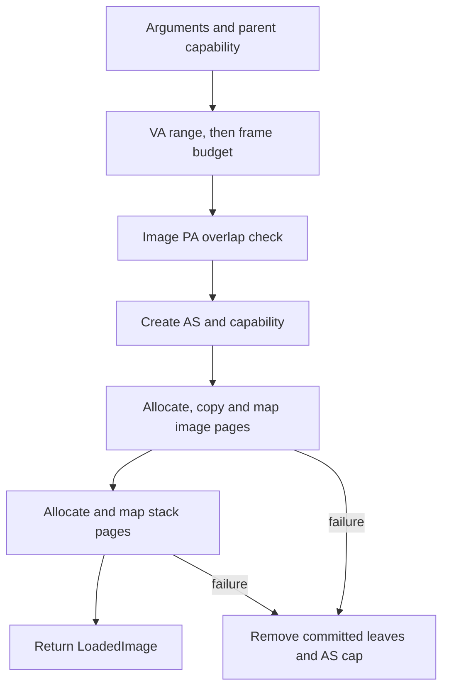

# Task loader

The task loader turns a trusted embedded raw-flat image into userspace mappings and a `LoadedImage` descriptor. The landed boot path then creates a Task capability, registers its execution context and schedules the first real EL0 `hello`. This chapter explains that composition, its validation and partial rollback, and the limits that must be addressed before general untrusted loading.

> **Last verified against:** 2026-10-13; source `4ad0b3d8a9d43310fcd937013131bffadcc803d7`; owner [T-045](../analysis/tasks/phase-b2/T-045-docs-overview-taskloader-arch-index.md).

## Context

[ADR-0029](../decisions/0029-initial-userspace-image-format.md) selects the raw-flat format; [ADR-0039](../decisions/0039-userland-build-pipeline.md) defines its build pipeline. The loader composes [capabilities](../glossary.md), the [ADR-0028 address-space object](../decisions/0028-address-space-data-structure.md), the [ADR-0035 PMM](../decisions/0035-physical-memory-manager.md) and the MMU. [T-019](../analysis/tasks/phase-b/T-019-task-loader.md) introduced loading, [T-024](../analysis/tasks/phase-b/T-024-task-create-from-image.md) added Task creation, and [T-028](../analysis/tasks/phase-b/T-028-el0-userspace-wireup.md) wired actual EL0 execution.

## Why a task-loader chapter

This is where PMM frames, page tables, capability tables and object arenas compose. Validation before mutation reduces the failure window; rollback removes committed leaf mappings and the new capability but does not reclaim every underlying resource. The distinction is essential: a successful trusted demo and leaf cleanup are not a transactional general-purpose process loader.

## Scope boundary (loaded state through scheduled EL0 execution)

The live path has four separate responsibilities:

| Stage | Owner | Result |
|-------|-------|--------|
| `load_image` | [`kernel/src/obj/task_loader.rs`](../../kernel/src/obj/task_loader.rs) | Populated AS plus `LoadedImage` metadata (entry, stack and AS cap). |
| `task_create_from_image` | Same module, T-024 | Resolves the AS capability, creates `Task { id, address_space_handle }`, inserts a Task capability. Rolls the new Task arena slot back if cap insertion fails. |
| `add_user_task` | [`kernel/src/sched/mod.rs`](../../kernel/src/sched/mod.rs), T-023 | Registers an EL0 context using loaded PC/SP, a per-task EL1 stack and caller-table binding. |
| BSP scheduling and exception glue | [`bsp-qemu-virt/src/main.rs`](../../bsp-qemu-virt/src/main.rs), T-028 | Activates the task's TTBR0, enters EL0 and handles its SVC/exit path. |

The `Task` object's lack of a register file does not prevent execution: the scheduler owns that context separately. `load_image` alone neither creates a Task object nor schedules it; `task_create_from_image` alone does not initialize execution context. The shared high-half kernel root remains in TTBR1 while the task's low root is installed in TTBR0, per [ADR-0033](../decisions/0033-kernel-high-half-migration.md) and [ADR-0028](../decisions/0028-address-space-data-structure.md). [ADR-0037](../decisions/0037-el0-entry-context.md) governs entry, and [ADR-0038](../decisions/0038-mmu-translate-and-user-access.md) governs USER-checked buffer translation; [ADR-0030](../decisions/0030-syscall-abi.md) / [ADR-0031](../decisions/0031-initial-syscall-set.md) govern syscalls.

## Design

### Pipeline (one §Simulation row at a time)

The eight loader stages correspond to [T-019's Simulation](../analysis/tasks/phase-b/T-019-task-loader.md#simulation). The diagram groups preflights to show the mutation and cleanup boundaries; the table preserves their order.

| Stage | Current checks / effects |
|-------|--------------------------|
| 1. Arguments | Reject empty image, zero stack pages and misaligned image base. |
| 2. Parent cap | Resolve a live AddressSpace capability and check kind. |
| 3. Span and budget | Validate the entire half-open image+stack VA range first, then available root/leaf/intermediate frame budget. |
| 4. Source overlap | Convert the image's kernel VA to PA; reject overlap with any frame the PMM could allocate. |
| 5. AS creation | `cap_create_address_space` enforces parent `DERIVE` authority and rights narrowing, then creates the root/AS/cap. Failure does not commit loader state. |
| 6. Image | Allocate zeroed leaf frames, copy image chunks, map `USER \| EXECUTE`. |
| 7. Stack | Allocate zeroed leaf frames, map `USER \| WRITE`. |
| 8. Descriptor | Return entry at image base and stack pointer one past the stack's highest byte. |

The mapped span must satisfy `span_end <= USERSPACE_VA_LIMIT`, where the limit is `1 << 48` under [ADR-0027](../decisions/0027-kernel-virtual-memory-layout.md). Equality is valid for the one-past end; no mapped byte is at that limit. Saturating arithmetic produces `usize::MAX` on overflow, which is rejected before the budget check. Base VA zero is legal: this loader does not enforce a null-page guard.

For the current 4 KiB VMSAv8 page-table format, the budget is `1 + image_pages + stack_pages + intermediate_frame_count(...)`. The helper counts distinct L3 tables covering 2 MiB, L2 tables covering 1 GiB and L1 tables covering 512 GiB across the contiguous span. For an 8 MiB image starting at 8 MiB plus one stack page, four image L3 tables plus one stack L3 table, one L2 and one L1 give **7 intermediates**. This is an exact count for the current fresh-root lazy-allocation implementation, not a format-independent HAL rule.

The overlap check uses `kernel_va_to_phys(image.as_ptr())` before querying `Pmm::could_yield_pa_overlapping`; comparing the high-half pointer directly with a PA range would be wrong. In the current BSP the embedded image is in reserved kernel `.rodata`, outside allocatable PMM frames. Host tests use offset zero. Destination writes use the centralized frame-to-kernel-pointer helper.

## Rollback contract

An image/stack allocation or map failure removes committed stack pages first, then image pages, each in reverse installation order. `cap_unmap` returns the leaf frame for `pmm.free_frame`. A just-allocated frame whose map failed is freed by the forward path before rollback. Cleanup errors do not replace the original error.

The new AS capability is dropped using `cap_drop`, not `cap_revoke`: it is a leaf in the derivation tree; dropping is rights-agnostic, whereas revocation requires `REVOKE` and retains the source cap. See [T-019's explicit rollback contract](../analysis/tasks/phase-b/T-019-task-loader.md#rollback-contract-explicit).

### v1 baseline leaks

Rollback does **not** reclaim the root L0 frame, intermediate L1/L2/L3 frames or the AS arena slot. Dropping the cap is not destruction of the AS. The trusted BSP boot path fails stop on a loader error and does not retry indefinitely. Complete reclamation must precede a general retrying/untrusted loader; a date or milestone alone does not close this debt. Current `task_exit` likewise stops scheduling without full Task/AS/capability reclamation. See [SECURITY.md](../../SECURITY.md) and the [Phase E memory/lifecycle work](../roadmap/phases/phase-e.md).

## Mapping flags

| Region | Flags | Effect / limit |
|--------|-------|----------------|
| Image | `MappingFlags::USER \| MappingFlags::EXECUTE` | Read/execute, no writable globals; partial final page remains zero-filled beyond the copied bytes. |
| Stack | `MappingFlags::USER \| MappingFlags::WRITE` | Read/write, non-executable; prevents execution from stack pages, not reuse of existing executable code such as ROP. |

Raw flat carries no section metadata, so the loader cannot give `.rodata` and `.text` different permissions or support a writable `.data` region separately. The present `hello` needs neither writable globals nor a userspace allocator. [ADR-0034](../decisions/README.md) reserves **kernel-image** section hardening; it is not a userspace image-format decision. The current kernel RAM window also remains RWX-equivalent despite these userspace leaf flags. Current `cap_map` / `cap_unmap` are kind-checked trusted kernel APIs without per-operation MAP rights or physical-memory ownership checks; see [`overview.md`](overview.md#address-spaces).

## Embedded image content (real hello)

[`userland/hello/src/main.rs`](../../userland/hello/src/main.rs) is a freestanding Rust program whose `_start` begins at offset zero, linked at `0x0080_0000` by [`hello.ld`](../../userland/hello/hello.ld). It attempts `console_write` through the seeded debug-console capability and then calls `task_exit(0)`. The console result is intentionally ignored: in normal release, number 5 returns `BadSyscallNumber`, and the task still exits normally. Its panic handler exits with code 101.

[ADR-0039](../decisions/0039-userland-build-pipeline.md)'s pipeline is `cargo build` for `aarch64-unknown-none` → pinned `rust-objcopy` → ignored `userland/hello/hello.bin` → BSP `include_bytes!`. [`tools/build-userland.sh`](../../tools/build-userland.sh) must run before building the BSP; [`tools/smoke.sh`](../../tools/smoke.sh) does this automatically for the matching profile when no explicit ELF is supplied. Debug and release share the `.bin` output path, so build/run those profiles sequentially.

**Historical B4 sample:** the original 8-byte `mov w0, #42; ret` blob exercised loading only. It is no longer the embedded runnable image. At the verified source baseline, freshly built `hello` is 117 bytes in debug and 69 bytes in release; these are measured artifacts, not permanent format constants. The retained [runtime report](../analysis/reports/2026-10-13-t045-architecture-verification.md) records both hashes and traces.

## Userspace VA layout

The BSP image base and the userspace link address are both `0x0080_0000` (8 MiB). This is a page-aligned choice within the 48-bit low range, not a formula derived from the kernel PA base and not evidence of an enforced null-page guard. Image and stack are contiguous: `stack_base = image_base + image_pages * PAGE_SIZE`; `stack_top_va = stack_base + stack_pages * PAGE_SIZE` is one past the mapped stack. The initial SP uses that top so a downward-growing stack enters the mapped range.

For either current image (less than one 4 KiB page) and the BSP's one-page stack, the layout is:

| Boundary | VA |
|----------|----|
| Image / entry | `0x0080_0000` |
| Stack base | `0x0080_1000` |
| Initial SP / one-past stack | `0x0080_2000` |

Fresh debug and release traces show `tyrne: high-half active`, entry into EL0 at PC `0x800000`, two SVC exceptions, `tyrne: userspace task exited` and `tyrne: all tasks complete`. Only debug prints `hello from userspace`. There is no current `tyrne: image loaded` banner: entry is observed in the exception log; SP/layout follow the loader and BSP setup, not a fabricated trace line. The report distinguishes manual exception counts from the smoke script's marker/fault assertions.

## Audit-log surface

The loader's production byte-copy loop contains one `unsafe` block. Its entry is [UNSAFE-2026-0027](../audits/unsafe-log.md); PMM zeroing and MMU descriptor access use UNSAFE-2026-0026 / 0025. These entries and their dated amendments document their respective implementation evidence. The running path additionally crosses the trap, user-copy, high-half transition and EL0-entry sites (0029–0032). This chapter introduces no unsafe code and does not turn a successful smoke into a global memory-safety proof.

## Test surface

At the source baseline, [`task_loader.rs`](../../kernel/src/obj/task_loader.rs) contains **42 `#[test]` functions**. They cover argument/cap/range/budget/overlap preflight, rights narrowing, loaded metadata, mapping flags and zero tails, intermediate-table arithmetic, mid-loop rollback and five Task-creation cases (successful mint, wrong kind, stale AS, full cap table with Task rollback, full Task arena). This is a source inventory, not a fresh host-test result.

Mid-loop tests use `FailingMapMmu` and the test-only `Pmm::force_alloc_failure_after` to reach paths that normal single-core budget preflight makes unlikely. Extra block-mapping and intermediate-allocation failure cases pin the page-table boundary. Fresh debug/release QEMU runs in the report exercise the composed boot-to-EL0 path; they do not replace the unit tests or prove resource reclamation.

## Invariants

- Argument, parent-capability, VA, budget and overlap preflights precede image/stack mapping mutation; AS creation has its own authority and allocation checks.
- The one-past VA end may equal `1 << 48`; an overflowing span is rejected.
- Image leaf pages are USER/read/execute; stack leaf pages are USER/read/write and non-executable.
- Source image PA cannot overlap PMM-allocatable frames at the copy site.
- Partial loader rollback removes committed leaves and the AS cap; root/intermediate/arena reclamation is explicitly outside that contract.
- Task creation and scheduler registration are distinct from loading; cap-table exhaustion during Task creation deallocates the newly created Task slot.

## Trade-offs

- Raw flat and a fixed link address make the first trusted image easy to build and audit, at the cost of relocation, section permissions and writable globals.
- Exact VMSAv8 budgeting avoids the old fixed-count underestimate but must be revisited for a different page-table format.
- Fail-stop boot wiring bounds use of the partial rollback path; it is unsuitable for a general repeating loader until full reclamation lands.

## Open questions

- General image format and validation for writable sections and untrusted binaries.
- Complete AS/frame/Task reclamation and lifecycle authority before repeated creation or loading.
- Stack guards and larger workloads beyond the fixed one-page userspace stack.

## Cross-references

- [`overview.md`](overview.md) — current kernel/userspace boundary and syscall limits.
- [`memory-management.md`](memory-management.md) — PMM and address-space details; refreshed by T-046.
- [`boot.md`](boot.md) — detailed boot stages; refreshed by T-046.
- [T-045 verification report](../analysis/reports/2026-10-13-t045-architecture-verification.md) — exact profile commands and retained evidence.
